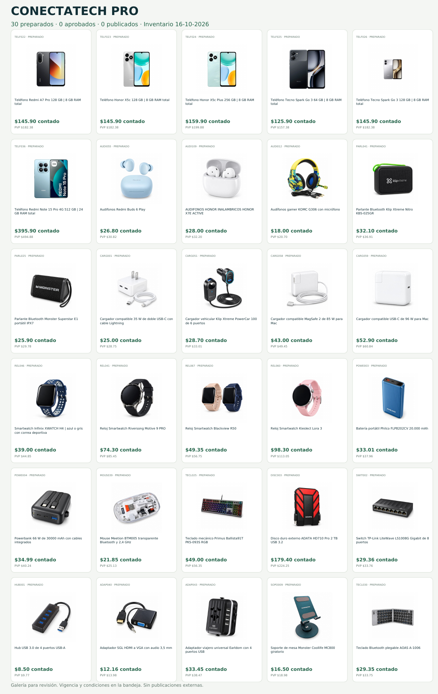

AVANCE — RED COMERCIAL CONECTATECH

**30 preparados · 0 aprobados externamente · 0 publicados por este lote.**

1. Canales operativos: bandeja local, descarga de imágenes/textos, fichas web y catálogo maestro Meta existente (945 productos, sincronización diaria confirmada por el propietario). No se activó una nueva fuente ni publicación.
2. Galería: [vista de los 30 anuncios](galeria/vista-30.png) · [PDF de cinco páginas](galeria/galeria-30.pdf).
3. Bloqueos: elegir categoría oficial en Marketplace y aprobar por SKU/canal. Rafa confirmó solo anuncios individuales. Shops/Seller/identidad empresarial y permisos API no se presumen disponibles.
4. Próxima ejecución: revisar el paquete, elegir un anuncio y autorizar expresamente su publicación manual mediante la función oficial de Rafa. No hay autorización para publicar este lote.

## Usar el paquete

[Descargar paquete de revisión](galeria/paquete-revision-30.zip), descomprimir y abrir paquete/index.html. También: [bandeja HTML](paquete/index.html) desde los archivos descargados, o servir la carpeta con un servidor local. GitHub muestra código HTML, no es hosting de esta bandeja. No se activó GitHub Pages ni se tocó el catálogo de producción. El paquete no depende de sesiones Meta, claves, servicios de pago ni una base de datos para preparar material.

En la bandeja: buscar, elegir canal, copiar título/texto, descargar imagen o texto, consultar ficha y exportar la revisión local. La revisión de un dispositivo no es aprobación del propietario. El visor solo almacena indicadores locales de revisión, sin datos de clientes.

## Evidencia real

- Se reutilizaron 30 imágenes aprobadas sin caja, con hash y contrato por SKU. Se verificaron por HTTP los 30 archivos públicos y las 30 fichas: precios y hashes coinciden con el lote.
- Inventario original adjuntado: Reporte-Inventario al 16-10-2026.xlsx. Contado = V. TOTAL; PVP final = PVP + importe PVP % IVA. No se tocó Sistema 593 ni se copiaron costos, márgenes o cantidades exactas al paquete.
- La vigencia heredada vence el 19-10-2026 a las 01:24:51 UTC; la bandeja muestra la hora de Ecuador y bloquea copiar/descargar textos vencidos. Los archivos descargados son instantáneas: el motor debe revalidar una exportación vigente, sin extender automáticamente este corte.
- Feed candidato: 25 filas con marca verificada; 5 referencias quedan excluidas por falta de marca/GTIN/MPN comprobable. El CSV de Rafa es una bandeja interna, no se afirma que sea un formato de carga masiva aceptado por Marketplace.
- Las condiciones de entrega fueron confirmadas expresamente por el propietario en data/entrega-oficial.json y aparecen en los 30 anuncios. No hay envío nacional contraentrega; tarifa nacional $6,90 con producto y envío pagados antes, sin inventar tiempos.
- La galería documental fue renderizada y revisada visualmente. La comprobación interactiva en Chromium fue bloqueada por política del entorno (ERR_BLOCKED_BY_ADMINISTRATOR para archivos locales); no se afirma validación interactiva móvil. Se incluye el guion para un entorno de navegador autorizado.
- TELF026: la fotografía aprobada muestra el producto pequeño en el lienzo. Se registró recomendación de encuadre, sin regenerar la imagen ni declarar una corrección hecha.

## Componentes reutilizables

`scripts/generar.py`: selección explícita de 30 SKU, verificación editorial/financiera y generación idempotente del paquete; lee la fuente, no la modifica. Reutiliza el lector XLSX del piloto de colaboradores en la misma rama.

`scripts/verificar_publico.py`: GET únicamente del dominio público CONECTATECH; compara hash de imagen y precio JSON-LD. No hace scraping de Meta. Produce feed revisado por HTTP, todavía sin aceptación en Commerce Manager.

`src/engine.mjs`: ocho estados, aprobación ligada a huella/contenido/canal, evidencia de publicación, detección selectiva de cambios, pausa por agotado/ausente y proyección de producto para Alex. `publishExternally()` rechaza toda ejecución.

`src/feed.mjs`: impide programar sincronización si faltan inventario vigente, capacidad de cuenta comprobada, aprobación expresa o evidencia reciente de las fichas. El feed separado no reemplaza la fuente maestra de Meta ni Google Merchant.

`scripts/registro.mjs`: registro local auditable por SKU y canal. Las mediciones requieren fuente, fecha y evidencia; usa la última observación por SKU/canal/métrica, evitando sumar dos capturas acumuladas. Valores desconocidos son null. Los períodos incompatibles se rechazan. Las ventas requieren confirmación administrativa, no clics o mensajes. Guardar el registro en una ruta privada fuera del repositorio. No es un CRM cloud desplegado.

## Verificaciones

Node 24: `npm test` y `npm run check` dentro de distribucion-pro. Ocho pruebas de lógica aprobadas. El generador se ejecutó con el inventario real; los importes se comprobaron con la ficha pública. No se ejecutó un workflow remoto ni se crearon servicios de facturación.

## Límites de la integración

No se implementó transporte de publicación oficial porque no existen permisos/credenciales comprobados ni aprobación de publicaciones. Alex recibe un contrato de lectura de productos; no se modifica su Worker ni se accede al Marketplace personal con Messenger empresarial. Las métricas, aprobaciones y publicaciones de prueba no se presentan como hechos reales.

[Auditoría de capacidades Meta](AUDITORIA-META.md). El catálogo maestro confirmado por el propietario es 1036301566100990, con 945 productos y conjunto CELULARES de 23. Este paquete no crea otro catálogo ni cambia su sincronización.
