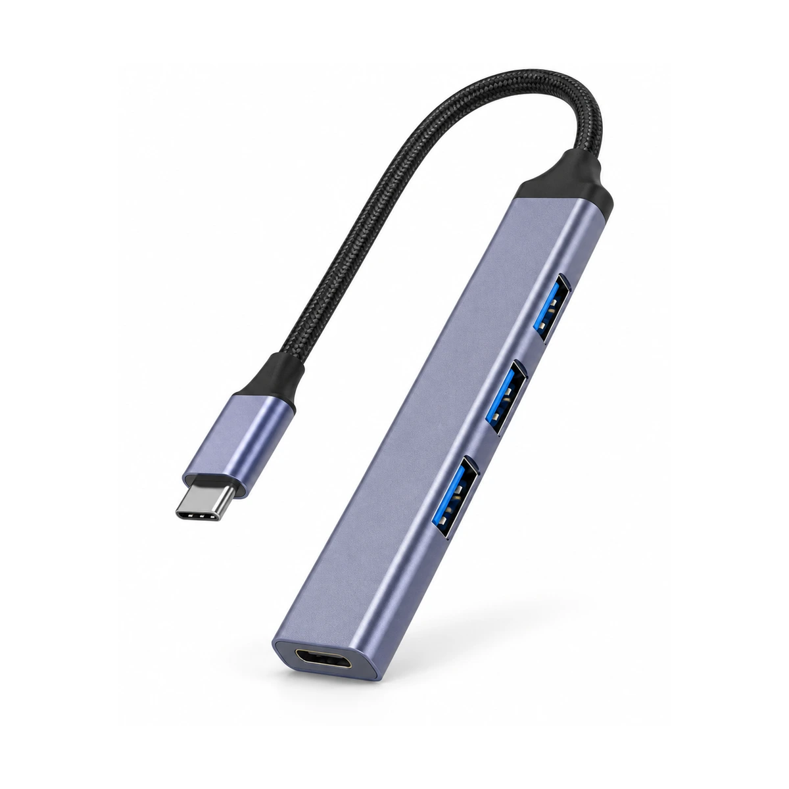
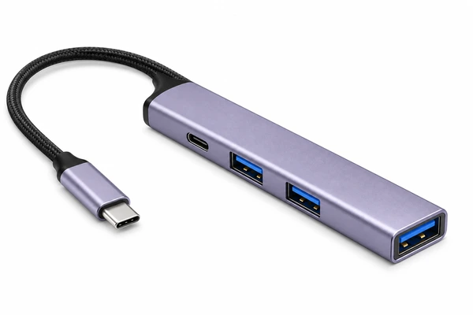
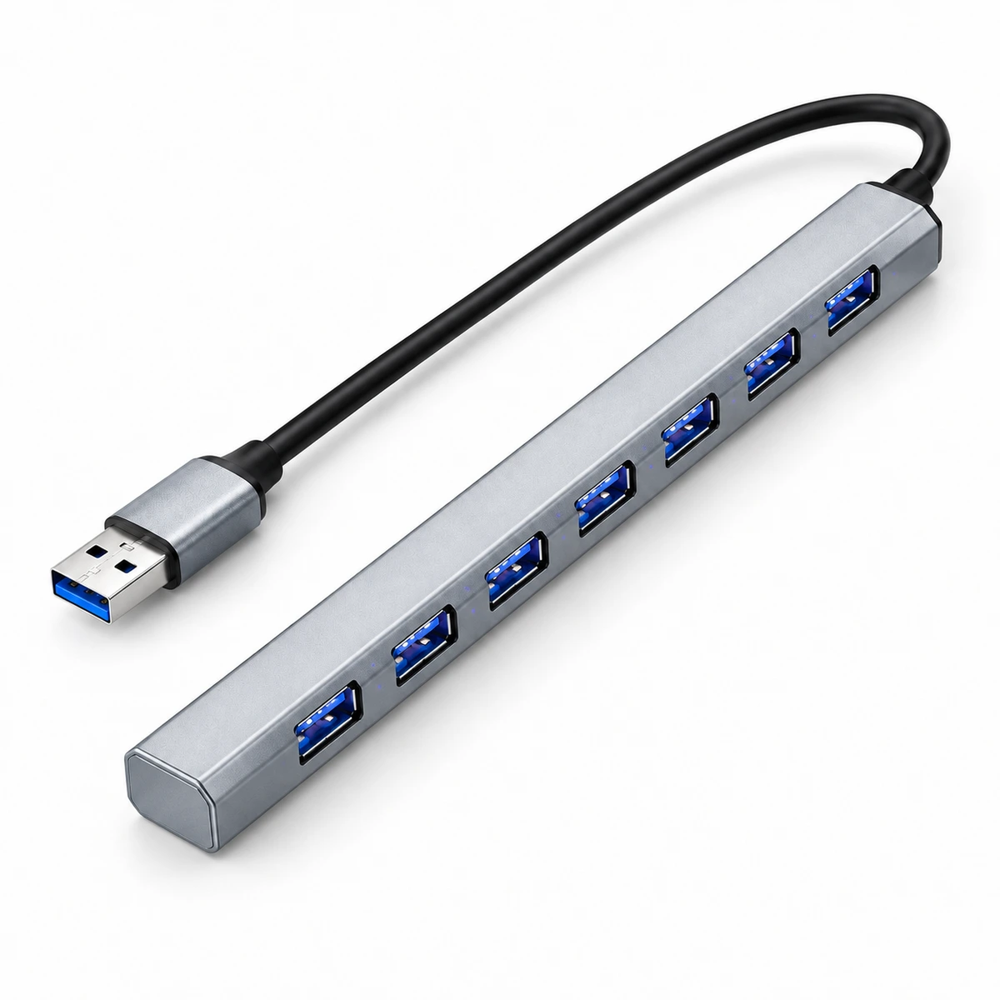
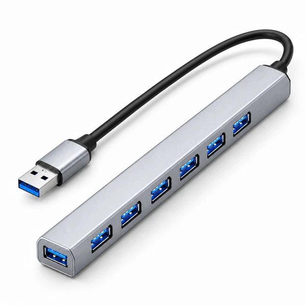

# CONECTATECH · pendientes y propuestas

**TELF001 y TELF012: APROBADOS Y CERRADOS por confirmación expresa del propietario.** Sin pendientes ni solicitudes de nuevas fotografías. Sus imágenes actuales se conservan.

**1.003 casos con imagen revisados o cerrados: 1.001 por revisión directa y 2 por aprobación del propietario.** Los cuatro CHIP001–CHIP004 recién incorporados fueron contrastados con sus fuentes y conservados. Revisión no equivale a aprobación física definitiva.

**Correcciones propuestas prioritarias · ninguna publicada**

## HUB016

| Imagen actual conservada | Propuesta para revisión |
| --- | --- |
|  |  |

El empaque propio documenta USB-C PD y dos USB-A en el lateral; tercer USB-A en el extremo. La imagen actual intercambia las posiciones.

## HUB027

| Imagen actual conservada | Propuesta para revisión |
| --- | --- |
|  |  |

El empaque propio documenta seis USB-A laterales y uno en el extremo. La portada actual sitúa los siete en el lateral y cierra el extremo.

## Cuántos faltan

| Situación | SKU |
| --- | ---: |
| Casos con imagen pendientes de auditoría inicial | 0 |
| Ya revisados, necesitan mejores referencias | 37 |
| Sin imagen declarada, etapa posterior | 195 |
| Propuestas preparadas en lotes47–48, todavía sin publicar | 16 |

Las 16 propuestas incluyen las dos correcciones anteriores y 14 vistas secundarias. CARG069 mantiene reserva sobre serigrafía técnica antes de sustituir una portada. Estas categorías no son una suma de errores confirmados.

[Ver las 8 propuestas del lote 47](https://github.com/conectatech-ec/conectatech-ec.github.io/blob/fotografia/propuestas-funcionales-20261103-47/revision/fotografia-funcionales-20261103-47/REVISION.md) · [Ver las 8 propuestas del lote 48](https://github.com/conectatech-ec/conectatech-ec.github.io/blob/fotografia/propuestas-conexiones-20261103-48/revision/fotografia-conexiones-20261103-48/REVISION.md)

Originales, hashes, títulos, precios, stock y producción intactos. La revisión automática anterior rechazó integrar en main; esta entrega permanece en una rama independiente.

## Los 37 SKU pendientes de mejores referencias

Ya tienen revisión inicial. La reserva indica qué falta para preparar una mejora fiel; no confirma por sí sola una fotografía incorrecta. Las imágenes actuales se conservan.

| SKU | Producto | Referencia que falta |
| --- | --- | --- |
| ADAP029 | Convertidor HDMI a RCA / MINI HDMI2AV | La vista disponible no muestra con claridad los puertos/ranuras requeridos; conservar hasta disponer de una vista física suficiente. |
| ADAP057 | Convertidor Treqa VGA a HDMI / HDV-552 | La vista disponible no muestra con claridad los puertos/ranuras requeridos; conservar hasta disponer de una vista física suficiente. |
| ADAP069 | Convertidor de audio digital a RCA | Se conserva la secundaria DC5V; la cara de entradas requiere una referencia legible adicional. |
| ADAP071 | Divisor HDMI 1 a 2 / Orvesion AWX-HD1X2 | La vista disponible no muestra con claridad los puertos/ranuras requeridos; conservar hasta disponer de una vista física suficiente. |
| ADAP072 | Adaptador USB-A 3.0 a HDMI | La vista disponible no muestra con claridad los puertos/ranuras requeridos; conservar hasta disponer de una vista física suficiente. |
| ADAP077 | Unión de red RJ45 / acoplador negro | La vista disponible no muestra con claridad los puertos/ranuras requeridos; conservar hasta disponer de una vista física suficiente. |
| ADAP094 | Adaptador de alimentación en L / blanco | La vista disponible no muestra con claridad los puertos/ranuras requeridos; conservar hasta disponer de una vista física suficiente. |
| CAPT003 | Capturadora HDMI a USB 3.0 con salida HDMI | Mejora de encuadre preparada. La vista actual no permite verificar la cara opuesta; no se inventa una vista de conectores. |
| CARG061 | Cable de carga para smartwatch Infinix H4 | Única fotografía física en ambas cuentas muestra el cable embolsado; no permite verificar número, separación ni disposición de pines. Conservar portada actual; falta vista física del extremo de contacto. |
| COBE001 | Cobertor decorativo para cargador | Mejora de encuadre preparada. Los orificios de carga requieren una referencia física legible adicional para mostrarlos sin reconstrucción. |
| CUBO011 | Cargador USB-A de 5 W para iPhone | La vista disponible no muestra con claridad los puertos/ranuras requeridos; conservar hasta disponer de una vista física suficiente. |
| ESTAB006 | Estabilizador Q18 con luz de relleno | Vista funcional abierta por verificar; no reconstruir el mecanismo desde la vista cerrada. |
| ESTAB007 | Estabilizador selfie C08 con trípode | Vista funcional abierta por verificar; conservar hasta cotejar el mecanismo exacto. |
| GADG004 | Ciclocomputador Sunding SD-563A con cable | Pantalla apagada; las referencias propias disponibles no permiten reproducir con fiabilidad la disposición de su información. Se conserva imagen publicada. |
| HUB014 | Hub Targus USB 2.0 de cuatro puertos | Los cuatro USB-A están declarados, pero las fotos recuperadas no muestran su disposición completa. |
| HUB024 | Hub UGREEN USB-C con tres USB-A y Ethernet Gigabit | Los puertos están declarados, pero la ubicación física de todos ellos no se distingue en las referencias recuperadas. |
| HUB026 | Hub UGREEN Uno CM888 USB-C 6 en 1 | Indicador comprobado en empaque, pero debe cotejarse la geometría de los puertos antes de una nueva representación. |
| JUGU034 | Carrito clásico con rayas / número 67 | Vehículo visualmente muy parecido a JUGU036, visto desde otro lado. Comparar referencias del SKU exacto antes de afirmar duplicado erróneo o sustituir. |
| JUGU036 | Miniatura Volkswagen Escarabajo / diseño Gulf azul y naranja número 67 | Comparar variante con JUGU034: similitud visual por sí sola no confirma fotografía equivocada. |
| LECT001 | Lector USB de Memorias — Modelos Surtidos | La vista disponible no muestra con claridad los puertos/ranuras requeridos; conservar hasta disponer de una vista física suficiente. |
| LECT002 | Lector Earldom ET-OT12 USB para tarjetas SD y microSD | La vista disponible no muestra con claridad los puertos/ranuras requeridos; conservar hasta disponer de una vista física suficiente. |
| PILA032 | Pila PKCELL AG10 / LR1130 | La cara visible no muestra la inscripción del modelo. Conservar la imagen y esperar una vista física legible de la cara marcada; no añadir texto ni sustituir la identidad. |
| PILA044 | Pila Renata tamaño 10 para audífonos | La cara visible no permite leer el modelo. Se conserva la foto actual; no publicar un reencuadre como solución de identidad ni añadir inscripciones sin una vista física legible. |
| PILA045 | Pila Renata tamaño 312 para audífonos | La cara visible no permite leer el modelo. Se conserva la foto actual; no publicar un reencuadre como solución de identidad ni añadir inscripciones sin una vista física legible. |
| PILA051 | Pila Murata 379 / SR521SW | La cara visible no muestra la inscripción del modelo. Conservar la imagen y esperar una vista física legible de la cara marcada; no añadir texto ni sustituir la identidad. |
| PILA058 | Pila Maxday AG7 | La cara visible no muestra la inscripción del modelo. Conservar la imagen y esperar una vista física legible de la cara marcada; no añadir texto ni sustituir la identidad. |
| PILA061 | Pila Maxday AG9 | La cara visible no muestra la inscripción del modelo. Conservar la imagen y esperar una vista física legible de la cara marcada; no añadir texto ni sustituir la identidad. |
| POWE015 | Powerbank TR-967 / 20.000 mAh y cables integrados | Indicador o ventana oscura: falta referencia legible para identificar su tipo y reproducirla encendida sin inventar cifras ni funciones. Se conserva. |
| RADI008 | Radio portátil LP V52 / panel solar | Pantalla apagada; las referencias propias disponibles no permiten reproducir con fiabilidad la disposición de su información. Se conserva imagen publicada. |
| REPR001 | Reproductor MP4 portátil Mrobo | Pantalla apagada; las referencias propias disponibles no permiten reproducir con fiabilidad la disposición de su información. Se conserva imagen publicada. |
| TECL029 | Teclado plegable Meetion BTK001 Bluetooth | Falta una referencia completa del teclado abierto para conservar exactamente sus teclas. |
| TRIP021 | Trípode selfie K26 con control integrado | Falta una vista verificable abierta del K26. |
| TRIP023 | Trípode selfie mini K03 extensible | Las referencias disponibles muestran el K03 cerrado; conservar hasta verificar el mecanismo abierto. |
| TRIP025 | Trípode selfie K10-L extensible | Falta una vista suficiente del K10-L con la base abierta. |
| TRIP026 | Tripode Selfie Bluetooth N08S | Las referencias muestran N08S y un manual Q07; verificar la correspondencia antes de reconstruir una vista abierta. |
| UPS001 | Mini UPS DC1036P — 36 W, Negro | Falta una vista legible de los conectores reales. |
| UPS002 | Mini UPS OLAX POE-D3 de 10000 mAh | El empaque muestra parte de los conectores; no basta para reconstruir toda la cara posterior. |
