# CONECTATECH · escala y correcciones verificables

**6 propuestas nuevas · ninguna publicada.** JUGU036 se conserva. TELF001 y TELF012 siguen aprobados y cerrados.

## Diferencia de presentación entre los juguetes

| JUGU034 · pequeño · propuesta | JUGU036 · mayor · imagen conservada |
| --- | --- |
| 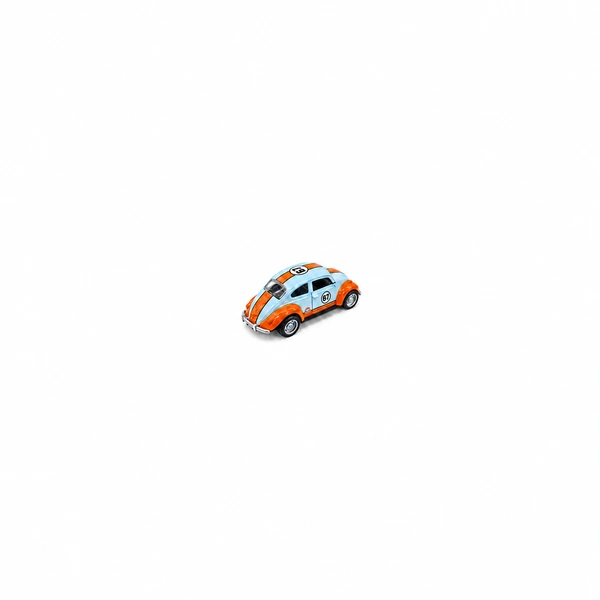 | 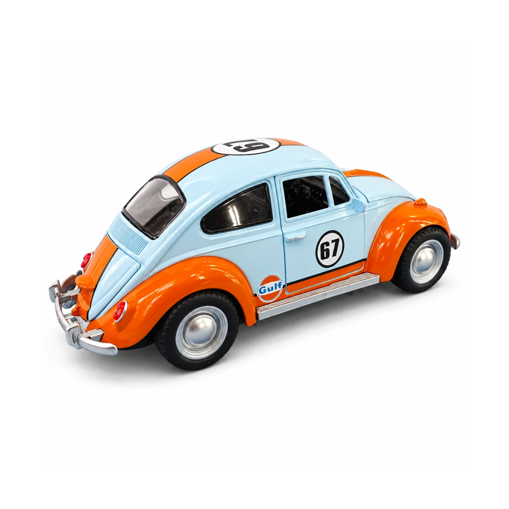 |

Comparación orientativa según la aclaración del propietario: aproximadamente cuatro veces en anchura visual dentro de tarjetas iguales. No son medidas físicas certificadas ni un conjunto de venta.

## JUGU034

| Actual conservada | Propuesta |
| --- | --- |
| 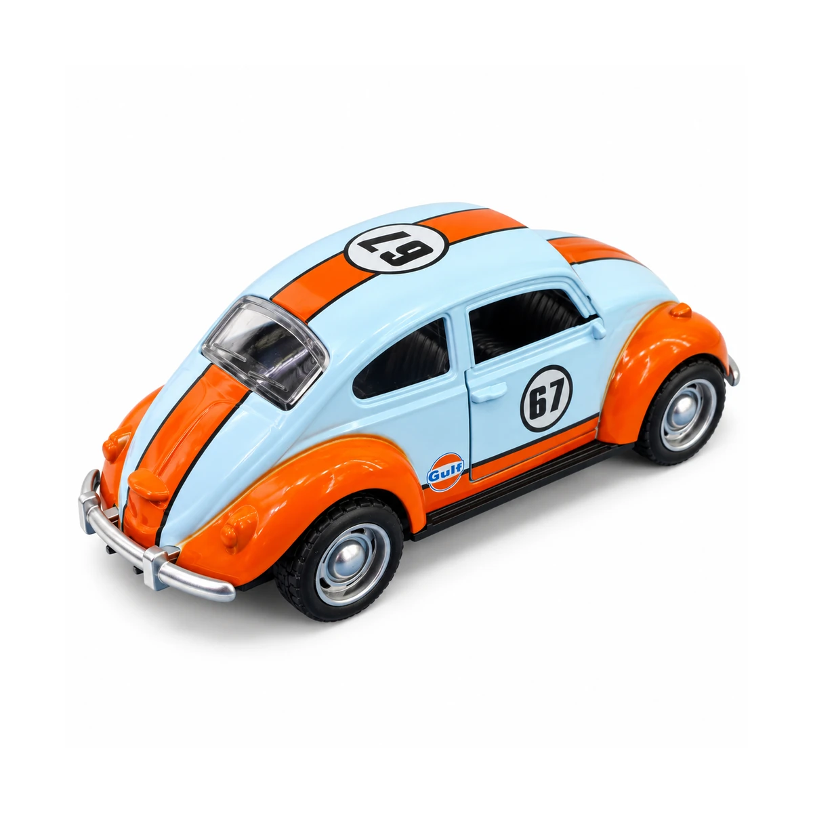 |  |

Encuadre reducido para distinguir el juguete pequeño de JUGU036. La identidad diferente y la diferencia aproximada de tamaño fueron confirmadas por el propietario; no se presentan medidas físicas inventadas.

[Descargar propuesta de 1200 px](propuestas/JUGU034-1200.webp)

## COBE004

| Actual conservada | Propuesta |
| --- | --- |
| 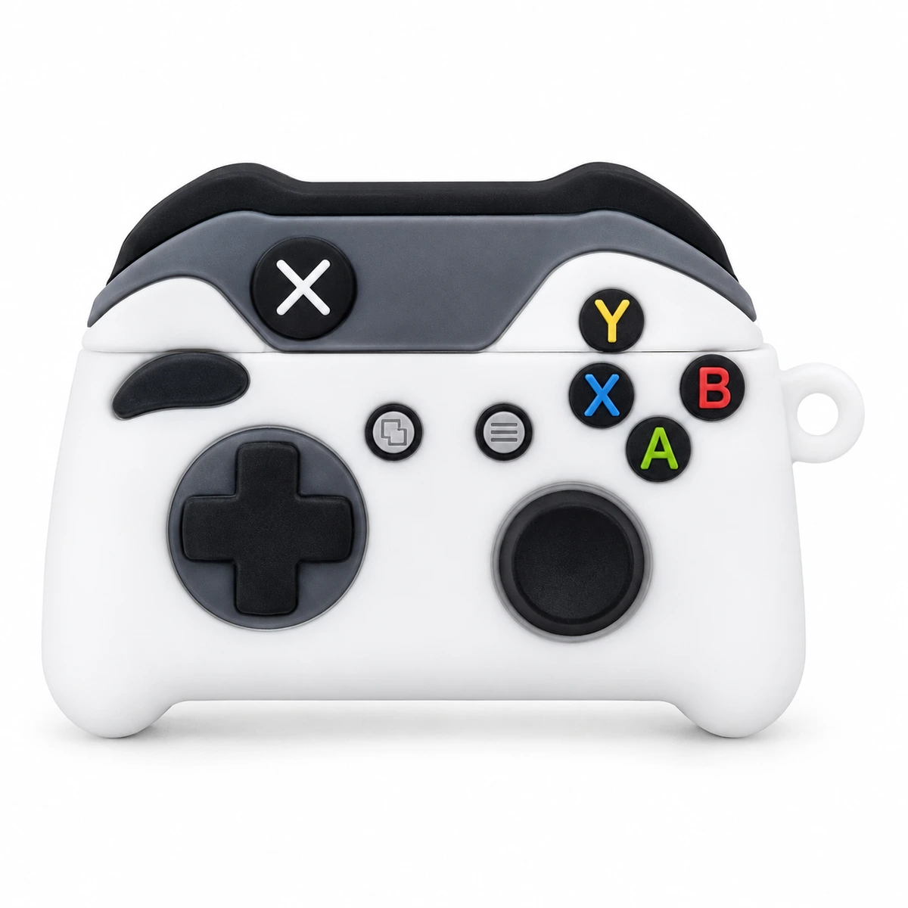 | 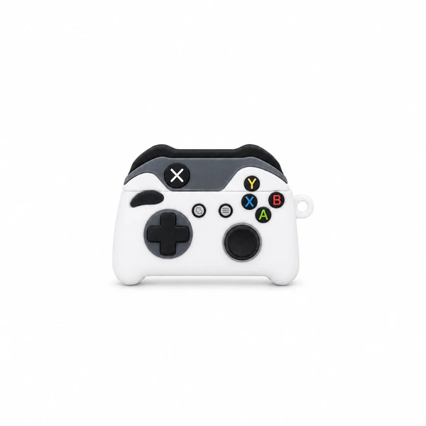 |

Presentación más pequeña: funda para estuche AirPods con diseño de control. Se conserva el diseño y no se añade un mando ni audífonos a la venta.

[Descargar propuesta de 1200 px](propuestas/COBE004-1200.webp)

## COBE006

| Actual conservada | Propuesta |
| --- | --- |
| 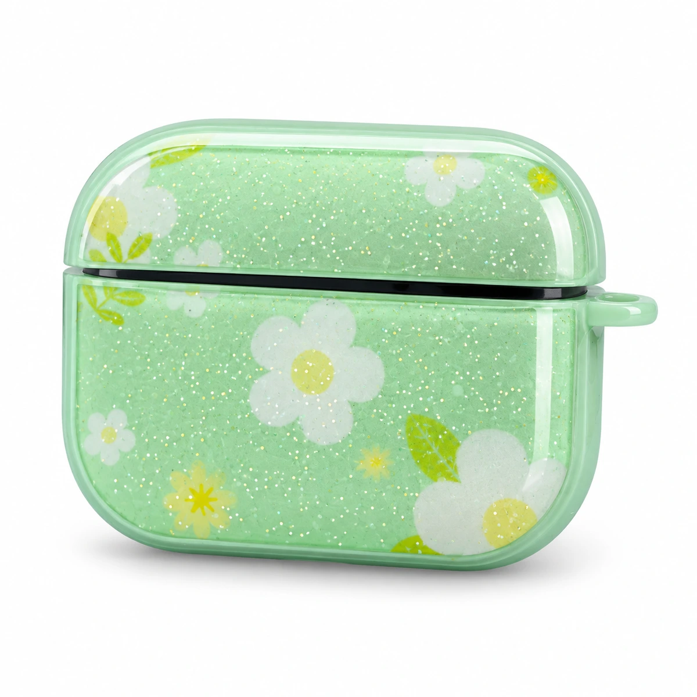 | 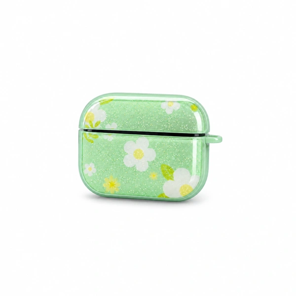 |

Presentación más pequeña del cobertor floral para estuche AirPods. Color, tapa y proporciones conservados en la propuesta.

[Descargar propuesta de 1200 px](propuestas/COBE006-1200.webp)

## COBE007

| Actual conservada | Propuesta |
| --- | --- |
| 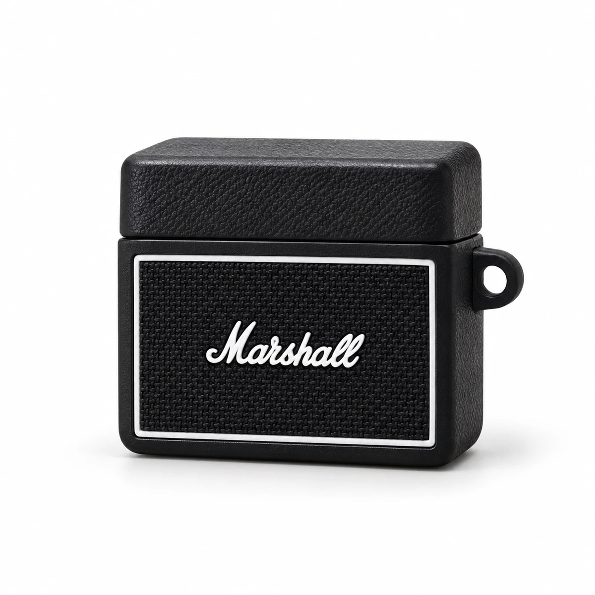 | 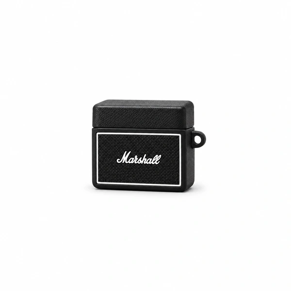 |

Presentación más pequeña del cobertor con diseño de amplificador; se reconoce como funda para estuche AirPods.

[Descargar propuesta de 1200 px](propuestas/COBE007-1200.webp)

## COBE009

| Actual conservada | Propuesta |
| --- | --- |
| 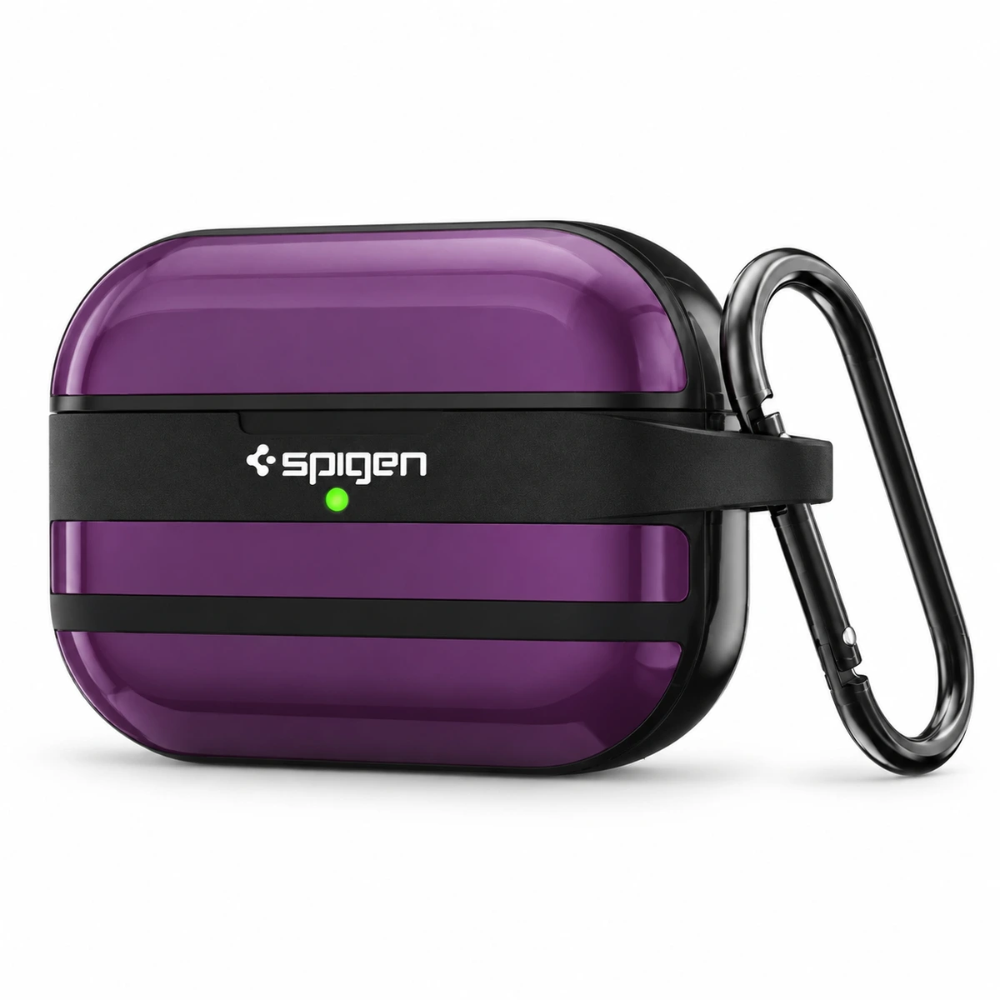 | 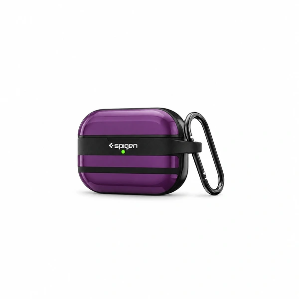 |

Presentación más pequeña del estuche Spigen con su mosquetón completo y diseño de origen.

[Descargar propuesta de 1200 px](propuestas/COBE009-1200.webp)

## HUB026

| Actual conservada | Propuesta |
| --- | --- |
| 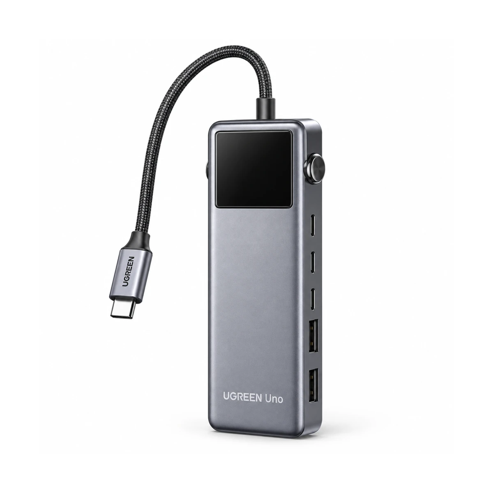 | 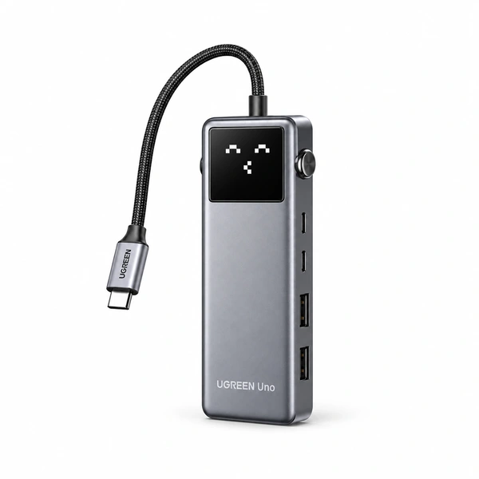 |

Corrección propuesta del lateral: dos USB-C y dos USB-A, frente a los tres USB-C y dos USB-A de la imagen actual. Indicador encendido con el rostro pixelado documentado en el empaque propio. Modelo CM888 / P/N 35998 contrastado con UGREEN.

[Descargar propuesta de 1200 px](propuestas/HUB026-1200.webp)

[Foto propia en Drive](https://drive.google.com/file/d/1jS5koACbsorGtOf6Ub5-ZSwKFxd-iVSl/view) · [Ficha del fabricante UGREEN 35998](https://eu.ugreen.com/products/ugreen-uno-6-in-1-usb-c-hub)

## Referencias localizadas para avanzar

- [Targus ACH114US](https://us.targus.com/products/4-port-hub-ach114us): coincide con el SKU del empaque propio; falta cotejo visual completo de sus puertos.
- [Meetion BTK001](https://www.meetion.com/mt-btk001white.html): página del fabricante y ambas mitades del teclado en el empaque propio; referencia para preparar una vista abierta conservando el color Pink del SKU.
- [UGREEN CM475 /60600](https://manuals.plus/m/afb58c01d7fd1476e87b3b2c0196984d98d34a16b9fe8a6f6d0bb75fa25c3290): manual del modelo alojado por tercero; no confundir con variante 20932.

Se investigaron los 35 casos restantes con búsquedas por modelo y fuentes propias. Los resultados genéricos o fichas técnicas sin vista suficiente no se convierten en correcciones aprobadas. **No se solicitan nuevas fotos en esta entrega.** [Registro por SKU y fuentes](referencias-web.json).

Propuestas asistidas. Se conservan los originales y sus hashes. Sin cambios en main ni datos comerciales. La integración sigue pendiente por el rechazo de revisión automática anterior; sólo se entrega en rama independiente.
