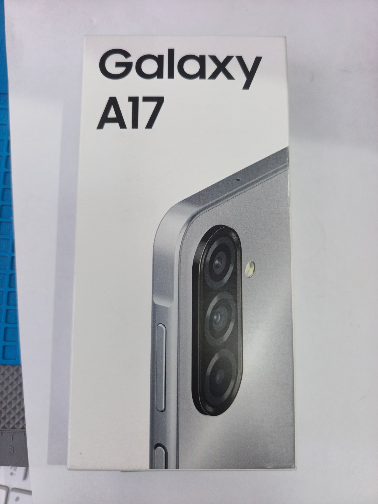
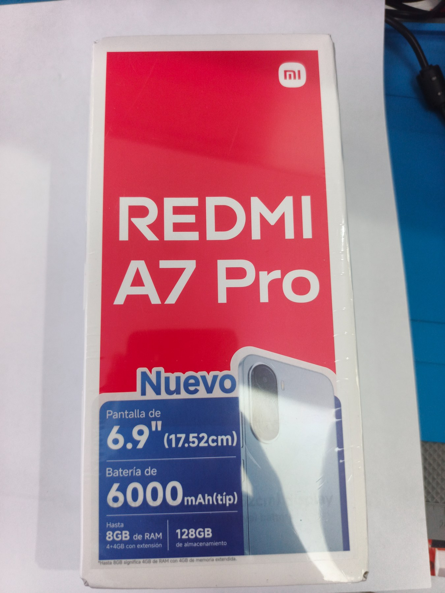

# CONECTATECH · Excepciones fotográficas

[Ver las 56 mejoras publicadas antes/después](https://conectatech-ec.github.io/revision/fotografia-masiva-20261103-44-45/)

**56 portadas y prioridad pública verificadas.** 997 de 999 imágenes con revisión registrada; no equivale a 997 aprobaciones definitivas de identidad. Se conservan 39 excepciones abiertas:30 prioritarias aquí y 9 adicionales en el registro. 199 SKU sin foto declarada quedan para después.

## Asociación resuelta: TELF012 Samsung A17 · TELF022 Redmi A7 Pro

| TELF012 · Samsung A17 de 256 GB | TELF022 · Redmi A7 Pro |
| --- | --- |
|  |  |

**Asociación aclarada por el propietario y verificada en Drive.** TELF012 es Samsung A17 de 256 GB; las cuatro referencias del Redmi A7 Pro ahora se llaman TELF022 y conservan sus ID. Ambas fotografías comerciales se conservan. Las cajas sirven sólo como evidencia de identificación.

## TELF012

[Abrir fotografía externa publicada](https://shop.samsung.com/latin/ecu/pub/media/catalog/product/s/m/sm-a175_galaxy-a17_lte_00.png) · acceso visual pendiente desde el entorno de auditoría.

Samsung A17 de 256 GB confirmado por el propietario. Las cuatro fotos del Redmi A7 Pro ya fueron renombradas TELF022 en Drive y su asociación quedó resuelta por ID. La fotografía externa del Samsung se conserva; su comprobación visual externa sigue pendiente desde este entorno.

Referencias propias: [1](https://drive.google.com/file/d/13iRcMxPrfGLGQooFGUC5_eHOOrrxBiBE/view?usp=drivesdk) · [2](https://drive.google.com/file/d/1W4Up0aMNdd-IVR38gHWK27LBjs8tBQXs/view?usp=drivesdk)

**Acción:** conservar la foto del Samsung; asociación del Redmi resuelta. Sólo queda la comprobación visual de la imagen externa.

## LECT001

La vista disponible no muestra con claridad los puertos/ranuras requeridos; conservar hasta disponer de una vista física suficiente.

Referencias propias: [1](https://drive.google.com/file/d/1Hma3cxkyp4plWA250Y8bFqvU57gEVaJA/view?usp=drivesdk)

**Acción:** conservar; nueva edición sólo con referencia física suficiente o aclaración de identidad.

## LECT002

La vista disponible no muestra con claridad los puertos/ranuras requeridos; conservar hasta disponer de una vista física suficiente.

Referencias propias: [1](https://drive.google.com/file/d/1J8EZNAueOVuvkhrrPtq0xuoFSAi_3vpV/view?usp=drivesdk) · [2](https://drive.google.com/file/d/1-5--Wj96dfyJny4tJAtK07WvawZfHv8i/view?usp=drivesdk)

**Acción:** conservar; nueva edición sólo con referencia física suficiente o aclaración de identidad.

## UPS001

Falta una vista legible de los conectores reales.

Referencias propias: [1](https://drive.google.com/file/d/12l6st0X3CsmS_t7gEpzuUJSt-X7hEXXs/view?usp=drivesdk) · [2](https://drive.google.com/file/d/1PLxi3ohKDR_9dZtxq3SNPsPUn7efrnVs/view?usp=drivesdk)

**Acción:** conservar; nueva edición sólo con referencia física suficiente o aclaración de identidad.

## UPS002

El empaque muestra parte de los conectores; no basta para reconstruir toda la cara posterior.

Referencias propias: [1](https://drive.google.com/file/d/110gCJy7dN_7eVg6_n3SHcONchDa1g636/view?usp=drivesdk) · [2](https://drive.google.com/file/d/1pUeNWa8Sw4ow3D3acToAeiHeEoq0gs9U/view?usp=drivesdk) · [3](https://drive.google.com/file/d/1HaiRXDpMUE7oKOV1awUCqePIR3lAMFq7/view?usp=drivesdk)

**Acción:** conservar; nueva edición sólo con referencia física suficiente o aclaración de identidad.

## HUB014

Los cuatro USB-A están declarados, pero las fotos recuperadas no muestran su disposición completa.

Referencias propias: [1](https://drive.google.com/file/d/1hASXmJyANroxZrQgD1Jvibi71Lc9bXMj/view?usp=drivesdk) · [2](https://drive.google.com/file/d/14zQhgXe_a7_xOdNRxP0LswaLByEhjIYK/view?usp=drivesdk)

**Acción:** conservar; nueva edición sólo con referencia física suficiente o aclaración de identidad.

## HUB024

Los puertos están declarados, pero la ubicación física de todos ellos no se distingue en las referencias recuperadas.

Referencias propias: [1](https://drive.google.com/file/d/1Eljpt4Q-tbHeEg3i2dmXoOeL28IKJMYT/view?usp=drivesdk) · [2](https://drive.google.com/file/d/1heGI0kVlVs8VupOvGJn8SBC8_xNJi2Nr/view?usp=drivesdk)

**Acción:** conservar; nueva edición sólo con referencia física suficiente o aclaración de identidad.

## HUB026

Indicador comprobado en empaque, pero debe cotejarse la geometría de los puertos antes de una nueva representación.

Referencias propias: [1](https://drive.google.com/file/d/1prtS1izGUsG2F3wzpY57WfrijYYDru0a/view?usp=drivesdk) · [2](https://drive.google.com/file/d/1HE4s9aosF0HRvduaz79eUho-1t18h2jR/view?usp=drivesdk) · [3](https://drive.google.com/file/d/1jS5koACbsorGtOf6Ub5-ZSwKFxd-iVSl/view?usp=drivesdk)

**Acción:** conservar; nueva edición sólo con referencia física suficiente o aclaración de identidad.

## ADAP029

La vista disponible no muestra con claridad los puertos/ranuras requeridos; conservar hasta disponer de una vista física suficiente.

Referencias propias: [1](https://drive.google.com/file/d/1DMtBr6KSIsMNq31HQ6hlk11uN2Bq2lwT/view?usp=drivesdk) · [2](https://drive.google.com/file/d/1DA1ExvSPBf-_rA2Weg3AcKe4FMbfMiJP/view?usp=drivesdk)

**Acción:** conservar; nueva edición sólo con referencia física suficiente o aclaración de identidad.

## ADAP057

La vista disponible no muestra con claridad los puertos/ranuras requeridos; conservar hasta disponer de una vista física suficiente.

Referencias propias: [1](https://drive.google.com/file/d/1EeRfYDQ2ehVc7kRb6kvQjS0gQI0HJ-BQ/view?usp=drivesdk) · [2](https://drive.google.com/file/d/10cYSNlg3TA9RoNB5SUmHhAy6_9-AO-1H/view?usp=drivesdk)

**Acción:** conservar; nueva edición sólo con referencia física suficiente o aclaración de identidad.

## ADAP069

Se conserva la secundaria DC5V; la cara de entradas requiere una referencia legible adicional.

Referencias propias: [1](https://drive.google.com/file/d/1CNdKw8KvmKUp2Ey9epvzxuKqDCRK7vaf/view?usp=drivesdk) · [2](https://drive.google.com/file/d/182j8a5HM5A1XHETwNjSOUdhdlZLRMbql/view?usp=drivesdk)

**Acción:** conservar; nueva edición sólo con referencia física suficiente o aclaración de identidad.

## ADAP071

La vista disponible no muestra con claridad los puertos/ranuras requeridos; conservar hasta disponer de una vista física suficiente.

Referencias propias: [1](https://drive.google.com/file/d/1PD8_veRqsvGvAyXKcn_0VOjtR_OFLfUx/view?usp=drivesdk) · [2](https://drive.google.com/file/d/1NjbIxwbEFZjOm6PHa_tqq5YiwrFxdZFz/view?usp=drivesdk)

**Acción:** conservar; nueva edición sólo con referencia física suficiente o aclaración de identidad.

## ADAP072

La vista disponible no muestra con claridad los puertos/ranuras requeridos; conservar hasta disponer de una vista física suficiente.

Referencias propias: [1](https://drive.google.com/file/d/1SOWDKIj3Z34RnXtQl7r0pB4ixCf780Qr/view?usp=drivesdk) · [2](https://drive.google.com/file/d/1OKkBznF0PaOWTYZE7waQHu7oE76lqUEV/view?usp=drivesdk)

**Acción:** conservar; nueva edición sólo con referencia física suficiente o aclaración de identidad.

## ADAP077

La vista disponible no muestra con claridad los puertos/ranuras requeridos; conservar hasta disponer de una vista física suficiente.

Referencias propias: [1](https://drive.google.com/file/d/1QheNPJmRCC6Et4qWH_whXQEMWTd4emt3/view?usp=drivesdk) · [2](https://drive.google.com/file/d/1qHuBFd_WCnLpsPJrKiGjZX7TPA4Pt-hK/view?usp=drivesdk)

**Acción:** conservar; nueva edición sólo con referencia física suficiente o aclaración de identidad.

## ADAP094

La vista disponible no muestra con claridad los puertos/ranuras requeridos; conservar hasta disponer de una vista física suficiente.

Referencias propias: [1](https://drive.google.com/file/d/1vvXLLXjvOdifTXxoMT4wYY0UtIvQNNaJ/view?usp=drivesdk)

**Acción:** conservar; nueva edición sólo con referencia física suficiente o aclaración de identidad.

## CARG061

Única fotografía física en ambas cuentas muestra el cable embolsado; no permite verificar número, separación ni disposición de pines. Conservar portada actual; falta vista física del extremo de contacto.

Referencias propias: [1](https://drive.google.com/file/d/1mhYCQjXIotIuEt0bifrXRVqvOU3nhYsX/view?usp=drivesdk)

**Acción:** conservar; nueva edición sólo con referencia física suficiente o aclaración de identidad.

## CUBO011

La vista disponible no muestra con claridad los puertos/ranuras requeridos; conservar hasta disponer de una vista física suficiente.

Referencias propias: [1](https://drive.google.com/file/d/1gxWMdNZpjBDIn93puqDROoRNRXzU_dJc/view?usp=drivesdk) · [2](https://drive.google.com/file/d/1_iHsiXNu1Ea9Zkn7y5cYAt1yDd4iRr4t/view?usp=drivesdk)

**Acción:** conservar; nueva edición sólo con referencia física suficiente o aclaración de identidad.

## CAPT003

Mejora de encuadre preparada. La vista actual no permite verificar la cara opuesta; no se inventa una vista de conectores.

Referencias propias: [1](https://drive.google.com/file/d/11MqYtXymXOHMF6sfY90gS3RxuminGnIZ/view?usp=drivesdk) · [2](https://drive.google.com/file/d/1uFfA5b6HGQK7l2Op052APyycqID8TGSi/view?usp=drivesdk)

**Acción:** conservar; nueva edición sólo con referencia física suficiente o aclaración de identidad.

## ESTAB006

Vista funcional abierta por verificar; no reconstruir el mecanismo desde la vista cerrada.

Referencias propias: [1](https://drive.google.com/file/d/1XggtR7HrrmFCPvinh0aa-wkbTRB3bPTg/view?usp=drivesdk) · [2](https://drive.google.com/file/d/17fmsnlT1MqQMneEIO1B18rE-WIefDWqg/view?usp=drivesdk) · [3](https://drive.google.com/file/d/1HCpFo_mGwSk0alQX1mPMwWeyTxshQVj8/view?usp=drivesdk)

**Acción:** conservar; nueva edición sólo con referencia física suficiente o aclaración de identidad.

## ESTAB007

Vista funcional abierta por verificar; conservar hasta cotejar el mecanismo exacto.

Referencias propias: [1](https://drive.google.com/file/d/12anKLKeN-twy9Mo2D1t4MQKG6ft0QLVv/view?usp=drivesdk) · [2](https://drive.google.com/file/d/1TdFg0dK13d884FK_QRvx6pyB2rUnTRaF/view?usp=drivesdk)

**Acción:** conservar; nueva edición sólo con referencia física suficiente o aclaración de identidad.

## TRIP026

Las referencias muestran N08S y un manual Q07; verificar la correspondencia antes de reconstruir una vista abierta.

Referencias propias: [1](https://drive.google.com/file/d/1sCPaizLslRlN63kJzCHw2TrbCNbF9Yq7/view?usp=drivesdk) · [2](https://drive.google.com/file/d/1lFi8FstkZtwbgJWkkSMwFPjc0GDrwce9/view?usp=drivesdk) · [3](https://drive.google.com/file/d/1yBokdGtipNASU71vlezk-VyWrvAwcgsB/view?usp=drivesdk) · [4](https://drive.google.com/file/d/1O8-BFh5QgytiQt5RsMoh9u_oW8yhdjIx/view?usp=drivesdk)

**Acción:** conservar; nueva edición sólo con referencia física suficiente o aclaración de identidad.

## TRIP021

Falta una vista verificable abierta del K26.

Referencias propias: [1](https://drive.google.com/file/d/1LkXVG7YEaBdVV4FotJnKn1rC1zBkHceL/view?usp=drivesdk)

**Acción:** conservar; nueva edición sólo con referencia física suficiente o aclaración de identidad.

## TRIP023

Las referencias disponibles muestran el K03 cerrado; conservar hasta verificar el mecanismo abierto.

Referencias propias: [1](https://drive.google.com/file/d/1awqOwAV36-i-rjjAmZPjPEoBY8vGK1Eu/view?usp=drivesdk) · [2](https://drive.google.com/file/d/1KpiFGBTA0NHma5VSBZoXS7l5xVa1lQe6/view?usp=drivesdk) · [3](https://drive.google.com/file/d/12eEx7NMSYwWoeHjGNFLQspmbzgX4e5LF/view?usp=drivesdk)

**Acción:** conservar; nueva edición sólo con referencia física suficiente o aclaración de identidad.

## TRIP025

Falta una vista suficiente del K10-L con la base abierta.

Referencias propias: [1](https://drive.google.com/file/d/1NBW661t-2S514jRSI7bRREjvYOtxEQFt/view?usp=drivesdk) · [2](https://drive.google.com/file/d/1TvN7Kbq5KRcGoMWtYRrlRI44jrvjgn4N/view?usp=drivesdk) · [3](https://drive.google.com/file/d/1FLMZHEYwszrU39miVX0FGMWprzAytagL/view?usp=drivesdk)

**Acción:** conservar; nueva edición sólo con referencia física suficiente o aclaración de identidad.

## TECL029

Falta una referencia completa del teclado abierto para conservar exactamente sus teclas.

Referencias propias: [1](https://drive.google.com/file/d/1lkxe1QkzpEF4W4r-zB71LtpWgkeeTVAE/view?usp=drivesdk) · [2](https://drive.google.com/file/d/1AP1FMU-LbV-mmrDwOtbgKWFtP71x7i2w/view?usp=drivesdk)

**Acción:** conservar; nueva edición sólo con referencia física suficiente o aclaración de identidad.

## COBE001

Mejora de encuadre preparada. Los orificios de carga requieren una referencia física legible adicional para mostrarlos sin reconstrucción.

Referencias propias: [1](https://drive.google.com/file/d/1yYmMlcm5o4jitsfJwzSn339CcejehYN0/view?usp=drivesdk) · [2](https://drive.google.com/file/d/1Xau0Ax5V0Xdx7gnkJP6K3XJw4TdviqtC/view?usp=drivesdk) · [3](https://drive.google.com/file/d/1VLNrb2_ilNZ0RS6PPPI8CZ2j_2j5c_ZL/view?usp=drivesdk)

**Acción:** conservar; nueva edición sólo con referencia física suficiente o aclaración de identidad.

## POWE015

Indicador o ventana oscura: falta referencia legible para identificar su tipo y reproducirla encendida sin inventar cifras ni funciones. Se conserva.

Referencias propias: [1](https://drive.google.com/file/d/18g8-ntYki07k2BU92VXt_dRXaCG-oAGk/view?usp=drivesdk) · [2](https://drive.google.com/file/d/1RcP_pFemFt81WfGjXfPe90PIjgtUWQFU/view?usp=drivesdk) · [3](https://drive.google.com/file/d/1Syw9irL2ok6gnevVUAXOG_aG3MlFjWKn/view?usp=drivesdk) · [4](https://drive.google.com/file/d/1vzcROxZyHXB7Av86nr-ZtnYpzGXSKHth/view?usp=drivesdk)

**Acción:** conservar; nueva edición sólo con referencia física suficiente o aclaración de identidad.

## GADG004

Pantalla apagada; las referencias propias disponibles no permiten reproducir con fiabilidad la disposición de su información. Se conserva imagen publicada.

Referencias propias: [1](https://drive.google.com/file/d/1aoHcBHU9PGZ98TxgKAG6MUjgxxW-l3ad/view?usp=drivesdk) · [2](https://drive.google.com/file/d/1AIcmtILkRNLELssUgcevb1WfCSRbx2-B/view?usp=drivesdk) · [3](https://drive.google.com/file/d/1TUrjvXidCJJMDns0ldGhzpm19hU7XXiR/view?usp=drivesdk) · [4](https://drive.google.com/file/d/1IAebi4ROSt20H0CkvDpnxuCBaLyAR9Kk/view?usp=drivesdk)

**Acción:** conservar; nueva edición sólo con referencia física suficiente o aclaración de identidad.

## REPR001

Pantalla apagada; las referencias propias disponibles no permiten reproducir con fiabilidad la disposición de su información. Se conserva imagen publicada.

Referencias propias: [1](https://drive.google.com/file/d/1u-W3UxN-uzv5EnDtTpVTVSTt-rWDtoNJ/view?usp=drivesdk) · [2](https://drive.google.com/file/d/1UqGKZOrWqF3S0fLKK99CgqEuDz9of3Uz/view?usp=drivesdk)

**Acción:** conservar; nueva edición sólo con referencia física suficiente o aclaración de identidad.

## TELF001

[Abrir fotografía externa publicada](https://advance.com.ec/web/image/product.template/3552/image_1920?unique=42c8e56) · acceso visual pendiente desde el entorno de auditoría.

Las tres referencias propias muestran únicamente empaque del ZTE Blade A56 Pro Z2474. La fotografía publicada es externa y no pudo comprobarse desde este entorno. Conservar; no reconstruir frontal, puertos ni color desde la caja.

Referencias propias: [1](https://drive.google.com/file/d/1xSds30vdSDCmf8rZVsNa_HWZ775TEU_G/view?usp=drivesdk) · [2](https://drive.google.com/file/d/1fHpZyblHg81AN7rdvdFVZUaZ-pQrL88I/view?usp=drivesdk) · [3](https://drive.google.com/file/d/1F3RtKIxv1Oxlo8X8HedEVAtGZnhcRcwg/view?usp=drivesdk)

**Acción:** conservar; nueva edición sólo con referencia física suficiente o aclaración de identidad.

## Otros 9 pendientes conservados

- **JUGU034:** Vehículo visualmente muy parecido a JUGU036, visto desde otro lado. Comparar referencias del SKU exacto antes de afirmar duplicado erróneo o sustituir.
- **PILA044:** La cara visible no permite leer el modelo. Se conserva la foto actual; no publicar un reencuadre como solución de identidad ni añadir inscripciones sin una vista física legible.
- **PILA045:** La cara visible no permite leer el modelo. Se conserva la foto actual; no publicar un reencuadre como solución de identidad ni añadir inscripciones sin una vista física legible.
- **JUGU036:** Comparar variante con JUGU034: similitud visual por sí sola no confirma fotografía equivocada.
- **PILA051:** La cara visible no muestra la inscripción del modelo. Conservar la imagen y esperar una vista física legible de la cara marcada; no añadir texto ni sustituir la identidad.
- **PILA032:** La cara visible no muestra la inscripción del modelo. Conservar la imagen y esperar una vista física legible de la cara marcada; no añadir texto ni sustituir la identidad.
- **PILA061:** La cara visible no muestra la inscripción del modelo. Conservar la imagen y esperar una vista física legible de la cara marcada; no añadir texto ni sustituir la identidad.
- **PILA058:** La cara visible no muestra la inscripción del modelo. Conservar la imagen y esperar una vista física legible de la cara marcada; no añadir texto ni sustituir la identidad.
- **RADI008:** Pantalla apagada; las referencias propias disponibles no permiten reproducir con fiabilidad la disposición de su información. Se conserva imagen publicada.

Sin cambios de fotos comerciales, títulos, precios, stock,SKU niURLs. Costo adicional: 0.
