# CONECTATECH · 8 propuestas visuales nuevas

**Una portada corregida propuesta y siete vistas secundarias. Ninguna está publicada.** Las imágenes actuales y los datos comerciales se conservan.

Referencias propias de Drive y del empaque del modelo exacto. Las propuestas son representaciones asistidas para revisión; no acreditan por sí mismas todas las características físicas.

## HUB027 · Hub USB-A De 7 Puertos

| Imagen actual conservada | Propuesta nueva |
| --- | --- |
| 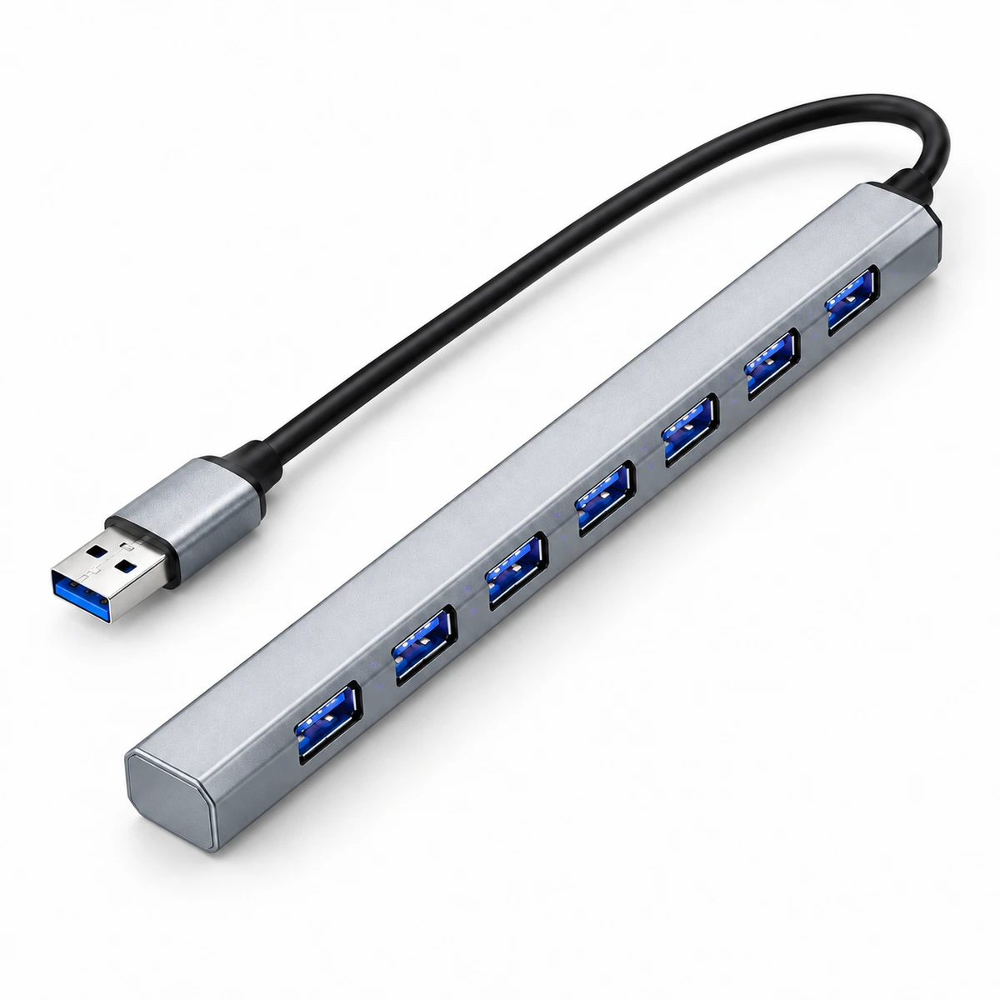 | 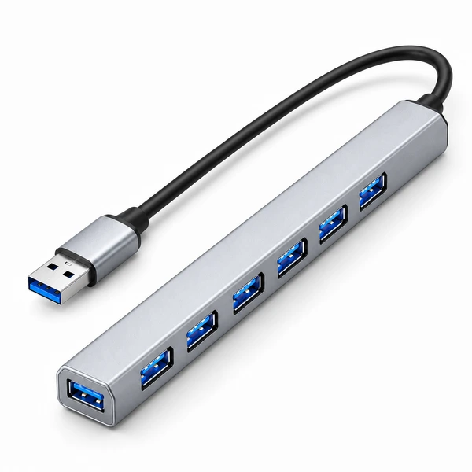 |

La portada actual sitúa 7 USB en el lateral y cierra el extremo. Las ilustraciones del modelo en el empaque propio muestran 6 laterales + 1 en el extremo. La propuesta reproduce esa disposición; requiere revisión antes de sustituir.

Referencias: [1](https://drive.google.com/file/d/1EuqwBy8yevyFXngA92mHsfM_1bObcHp2/view) · [2](https://drive.google.com/file/d/1cPoR-EXIw8krxA42nXEuqPzAF8WgoppJ/view)

[Descargar propuesta de 1200 px](propuestas/HUB027-1200.webp)

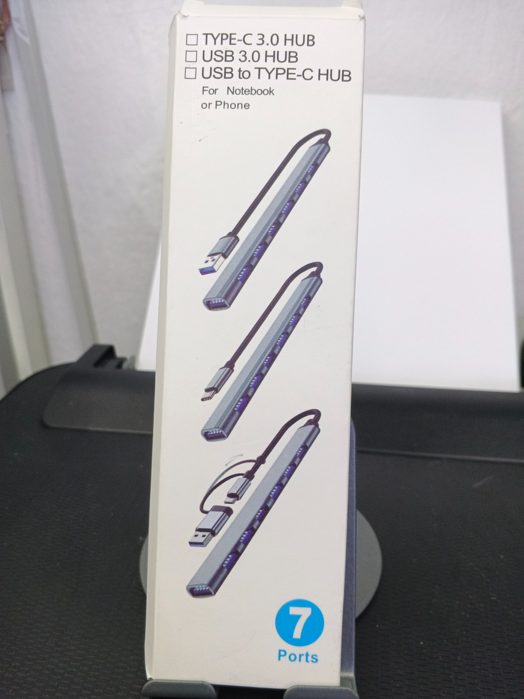

## HUB015 · Hub HP USB 2.0 de cuatro puertos

| Imagen actual conservada | Propuesta nueva |
| --- | --- |
| 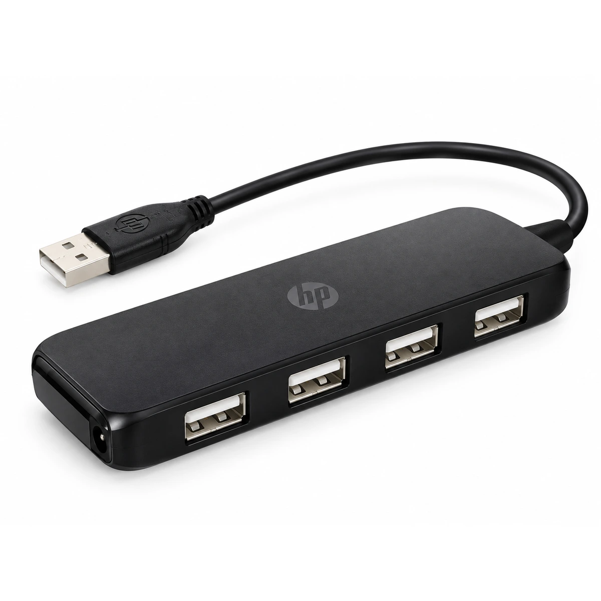 | 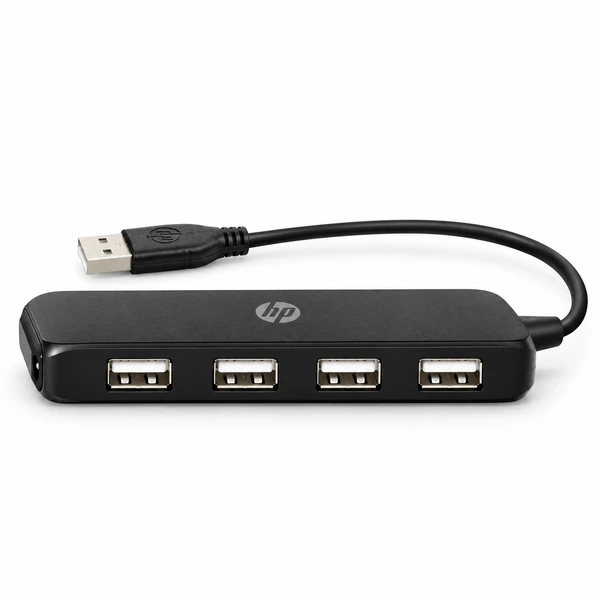 |

Cuatro USB-A vistos de frente; cable y conector USB-A completos.

Referencias: [1](https://drive.google.com/file/d/1J6WI13CUf7L5pXQUmwZ1NTcqspZx_CW5/view) · [2](https://drive.google.com/file/d/1KViktc7qDhVLuBytsX6FV9A5KtpPBfEY/view)

[Descargar propuesta de 1200 px](propuestas/HUB015-1200.webp)

## HUB030 · Hub Belkin USB-C de cinco puertos con HDMI 4K

| Imagen actual conservada | Propuesta nueva |
| --- | --- |
| 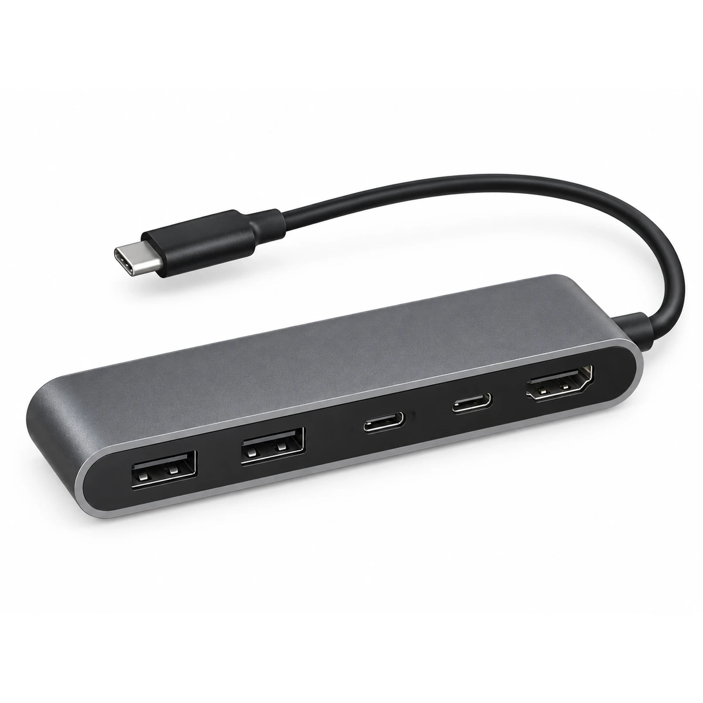 | 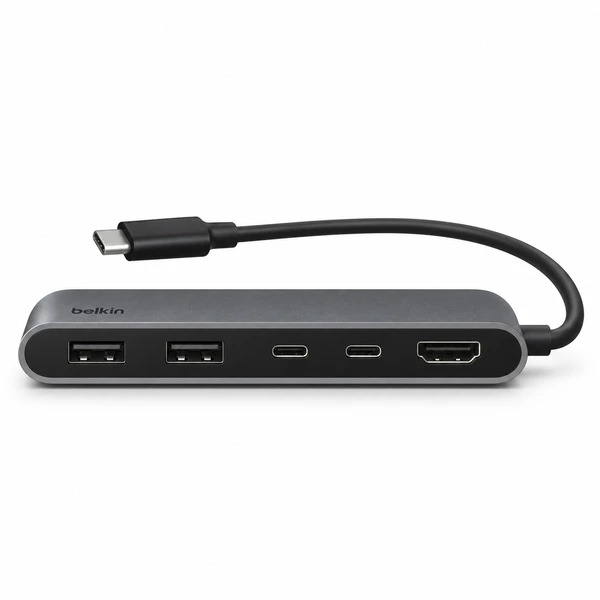 |

Panel frontal con dos USB-A, dos USB-C y HDMI; marca Belkin según referencia del modelo.

Referencias: [1](https://drive.google.com/file/d/1ep2VE5y1f8XYsjcBqvuI8Vh0BT_AUFgF/view) · [2](https://drive.google.com/file/d/1bhYYJ9LJDefW1478mnTD_HRAIMEjc0E6/view)

[Descargar propuesta de 1200 px](propuestas/HUB030-1200.webp)

## HUB012 · Hub Orvesion USB-C con HDMI y VGA

| Imagen actual conservada | Propuesta nueva |
| --- | --- |
| 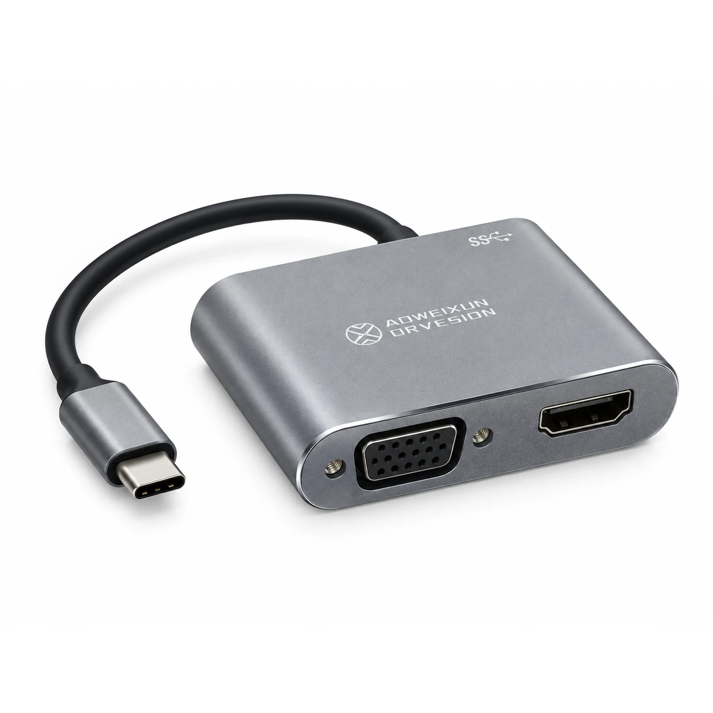 | 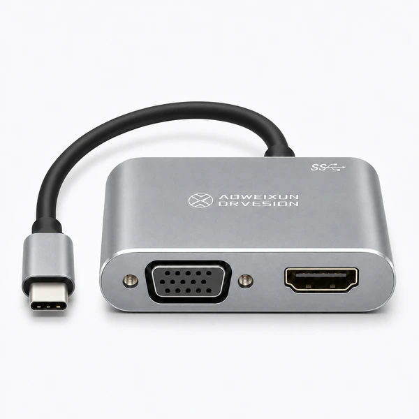 |

VGA y HDMI de frente; los 15 orificios VGA se comprobaron individualmente.

Referencias: [1](https://drive.google.com/file/d/1d6-WcVY12FvzffCU10x9zl6xYp9QDTQ9/view) · [2](https://drive.google.com/file/d/1ai4YOeyNqDX-Y3FwH3qZbkmDWqWZwaQ5/view)

[Descargar propuesta de 1200 px](propuestas/HUB012-1200.webp)

## ROUT002 · Sistema Mesh Cudy M1500 Wi-Fi 6 de tres módulos

| Imagen actual conservada | Propuesta nueva |
| --- | --- |
|  | 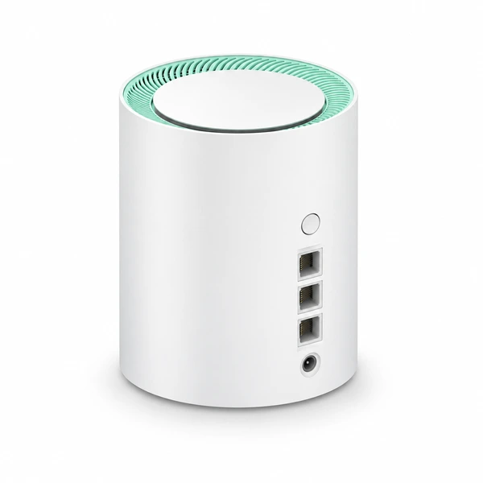 |

Vista posterior de UN módulo, con tres RJ45 y entrada de corriente según empaque. El SKU conserva el kit de TRES módulos; esta vista no cambia la cantidad vendida.

Referencias: [1](https://drive.google.com/file/d/1SHuBQGkFcMWYfWI-p-nc2NEX3mFF2YPg/view) · [2](https://drive.google.com/file/d/1n-WjoeSKsyPp3jrbjdJnT7g7Io59gXiv/view)

[Descargar propuesta de 1200 px](propuestas/ROUT002-1200.webp)

## ADAP092 · Adaptador 3,5 mm macho a macho | metálico

| Imagen actual conservada | Propuesta nueva |
| --- | --- |
| 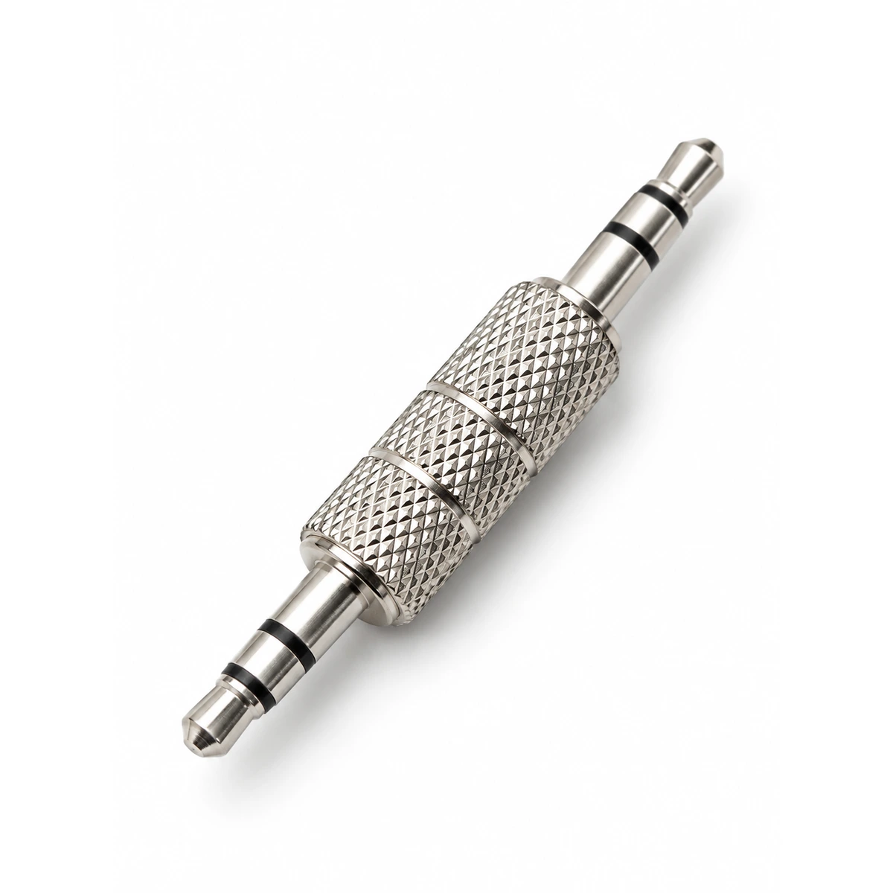 | 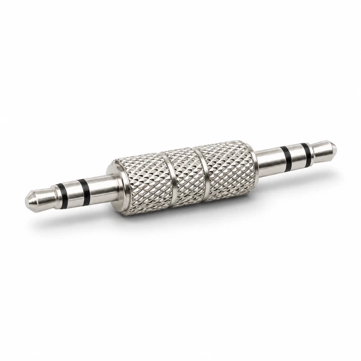 |

Ambas clavijas de 3,5 mm visibles en presentación horizontal, con acabado metálico y dos anillos aislantes en cada extremo.

Referencias: [1](https://drive.google.com/file/d/10ZbZ-CvVVlZSvq4CJNwk0bLb5KHJin1q/view)

[Descargar propuesta de 1200 px](propuestas/ADAP092-1200.webp)

## ADAP096 · Adaptador coaxial en ángulo | conexión compacta

| Imagen actual conservada | Propuesta nueva |
| --- | --- |
| 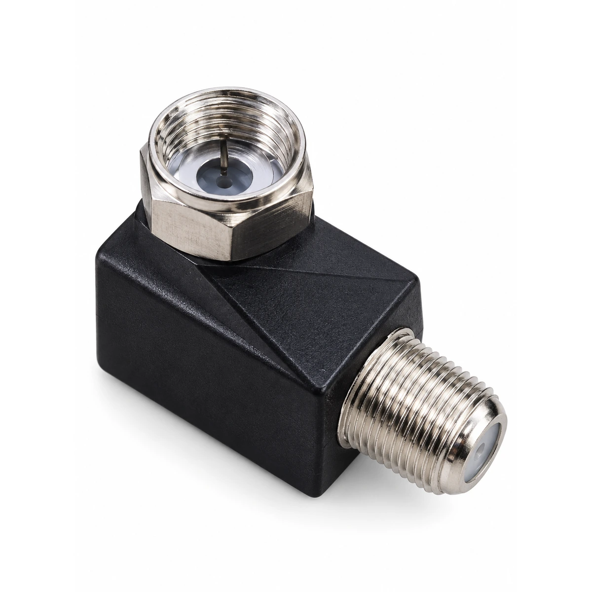 | 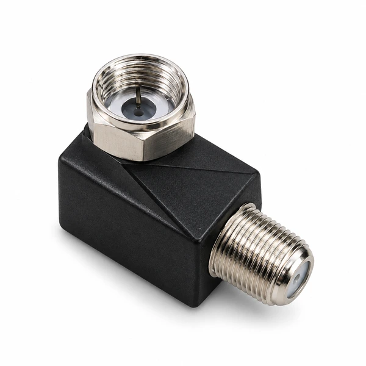 |

Dos extremos coaxiales y cuerpo acodado completos; presentación sin bolsa, mano ni etiqueta.

Referencias: [1](https://drive.google.com/file/d/1cr4ZKGBBN-gqLgAQCV-XQy44iPmypkyM/view) · [2](https://drive.google.com/file/d/1_D6RjKwvCxj3FrGamfV2dkgemlwK48uE/view)

[Descargar propuesta de 1200 px](propuestas/ADAP096-1200.webp)

## CAMA001 · Mini cámara de seguridad | formato compacto

| Imagen actual conservada | Propuesta nueva |
| --- | --- |
| 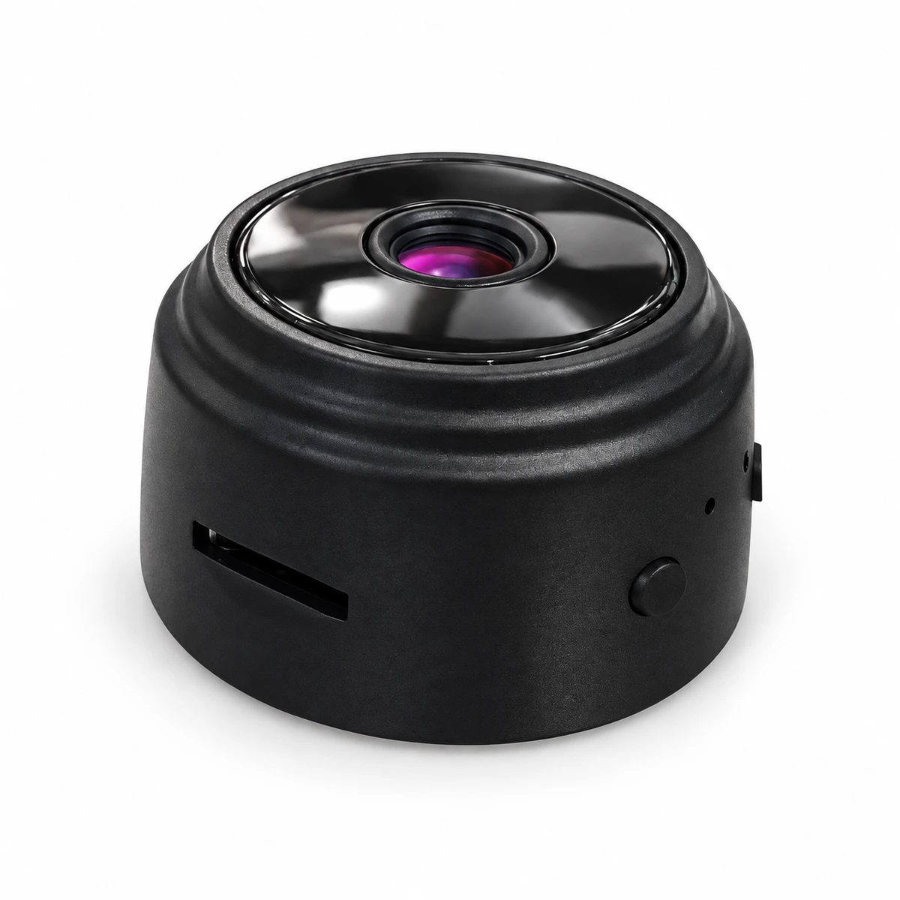 | 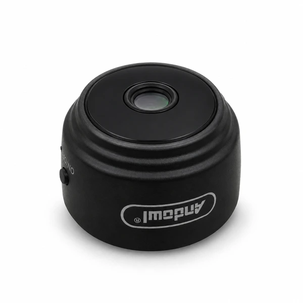 |

Vista del lente y cuerpo desde la foto física, con marca y orientación de origen. Fondo limpio y reflejos de mostrador eliminados.

Referencias: [1](https://drive.google.com/file/d/1OlDOlUUOzx78XbFfn52Q3Ng4YsNEfcRf/view)

[Descargar propuesta de 1200 px](propuestas/CAMA001-1200.webp)
