# CONECTATECH ·56 mejoras de encuadre

**56 portadas publicadas y verificadas.** Se comprobaron482 archivos porSHA enHTTP y112 casos enChromium público, en móvil y escritorio. El parche de fechas reales y prioridad ya está integrado y está pendiente de su comprobación final enPages.

[Ver la galería web](https://conectatech-ec.github.io/revision/fotografia-masiva-20261103-44-45/)

126 fotografías revisadas:56 propuestas y70 conservadas. Dos imágenes externas sin acceso visual. Se reutilizan los maestros completos, sin modificar marcas, modelo, unidades, terminales ni proporciones.

## Tanda 44 ·29 SKU

| SKU y producto | Antes | Mejora preparada |
| --- | --- | --- |
| **PILA001** · Pila alcalina PKCELL de 9 V | [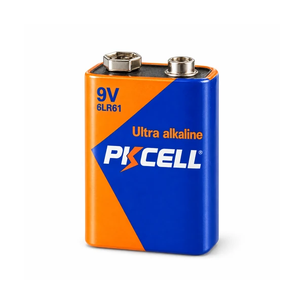](https://raw.githubusercontent.com/conectatech-ec/conectatech-ec.github.io/41bbf55862660043e826d2945b884728f2bfe9a6/imagenes/pila001/PILA001-01.webp) | [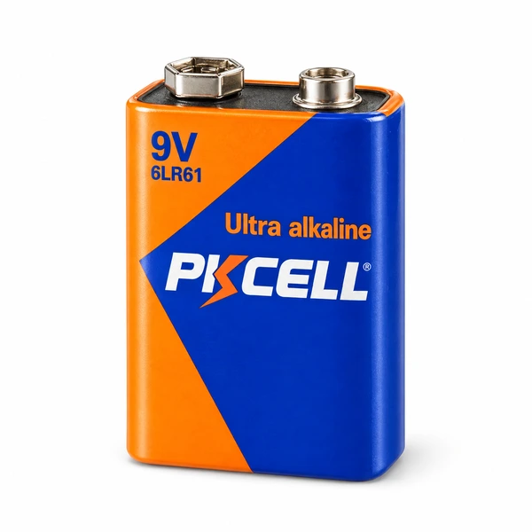](https://raw.githubusercontent.com/conectatech-ec/conectatech-ec.github.io/41bbf55862660043e826d2945b884728f2bfe9a6/imagenes/pila001/PILA001-r2026110344-01.webp) |
| **PILA003** · Pila alcalina Rayovac de 9 V | [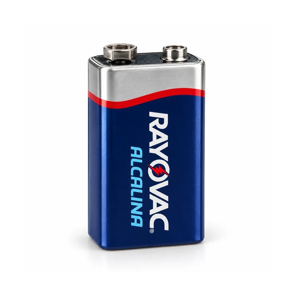](https://raw.githubusercontent.com/conectatech-ec/conectatech-ec.github.io/41bbf55862660043e826d2945b884728f2bfe9a6/imagenes/pila003/PILA003-01.webp) | [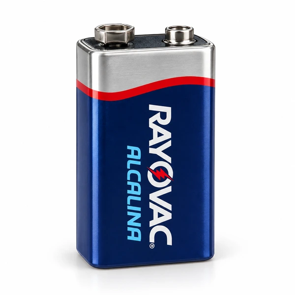](https://raw.githubusercontent.com/conectatech-ec/conectatech-ec.github.io/41bbf55862660043e826d2945b884728f2bfe9a6/imagenes/pila003/PILA003-r2026110344-01.webp) |
| **PILA004** · Pila alcalina Maxday de 9 V | [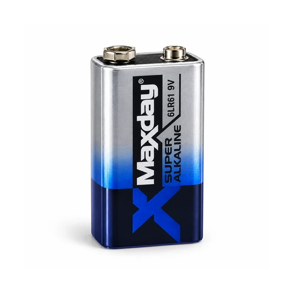](https://raw.githubusercontent.com/conectatech-ec/conectatech-ec.github.io/41bbf55862660043e826d2945b884728f2bfe9a6/imagenes/pila004/PILA004-01.webp) | [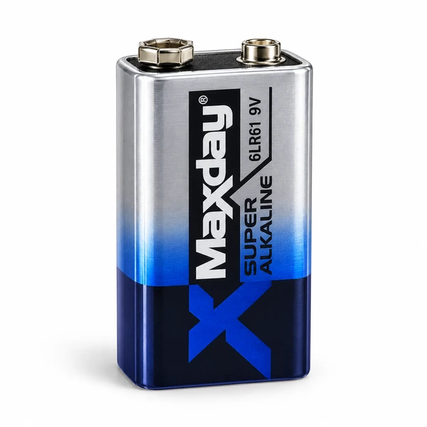](https://raw.githubusercontent.com/conectatech-ec/conectatech-ec.github.io/41bbf55862660043e826d2945b884728f2bfe9a6/imagenes/pila004/PILA004-r2026110344-01.webp) |
| **PILA005** · Pila recargable Maxday Ni-MH de 9 V | [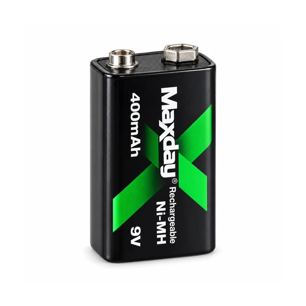](https://raw.githubusercontent.com/conectatech-ec/conectatech-ec.github.io/41bbf55862660043e826d2945b884728f2bfe9a6/imagenes/pila005/PILA005-01.webp) | [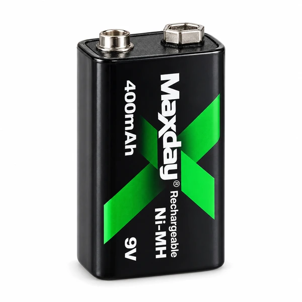](https://raw.githubusercontent.com/conectatech-ec/conectatech-ec.github.io/41bbf55862660043e826d2945b884728f2bfe9a6/imagenes/pila005/PILA005-r2026110344-01.webp) |
| **PILA007** · Pilas recargables MP Multiple Power AA, paquete de 2 | [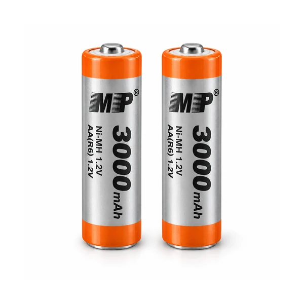](https://raw.githubusercontent.com/conectatech-ec/conectatech-ec.github.io/41bbf55862660043e826d2945b884728f2bfe9a6/imagenes/pila007/PILA007-01.webp) | [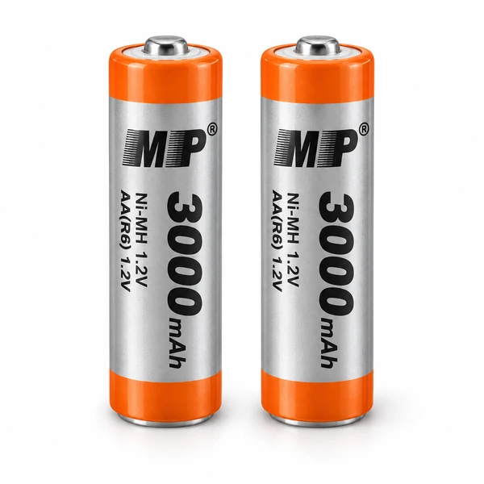](https://raw.githubusercontent.com/conectatech-ec/conectatech-ec.github.io/41bbf55862660043e826d2945b884728f2bfe9a6/imagenes/pila007/PILA007-r2026110344-01.webp) |
| **PILA023** · Pilas Rayovac AA \| paquete de 2 | [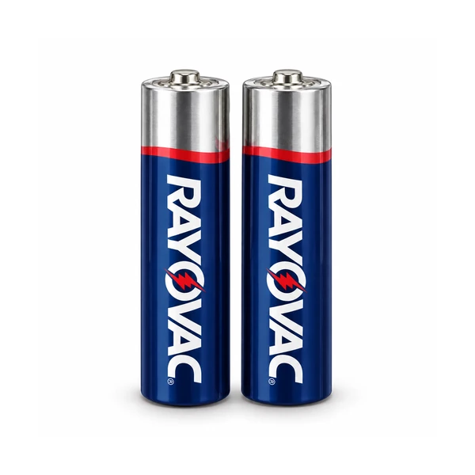](https://raw.githubusercontent.com/conectatech-ec/conectatech-ec.github.io/41bbf55862660043e826d2945b884728f2bfe9a6/imagenes/pila023/PILA023-01.webp) | [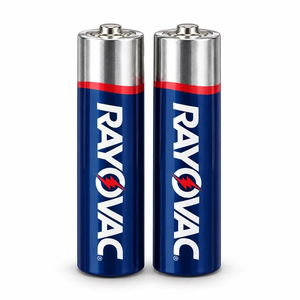](https://raw.githubusercontent.com/conectatech-ec/conectatech-ec.github.io/41bbf55862660043e826d2945b884728f2bfe9a6/imagenes/pila023/PILA023-r2026110344-01.webp) |
| **PILA026** · Pilas RCA AAA \| paquete de 4 | [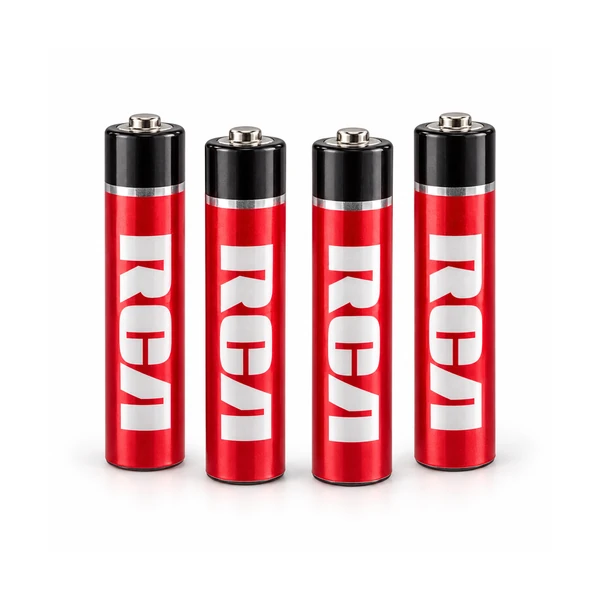](https://raw.githubusercontent.com/conectatech-ec/conectatech-ec.github.io/41bbf55862660043e826d2945b884728f2bfe9a6/imagenes/pila026/PILA026-01.webp) | [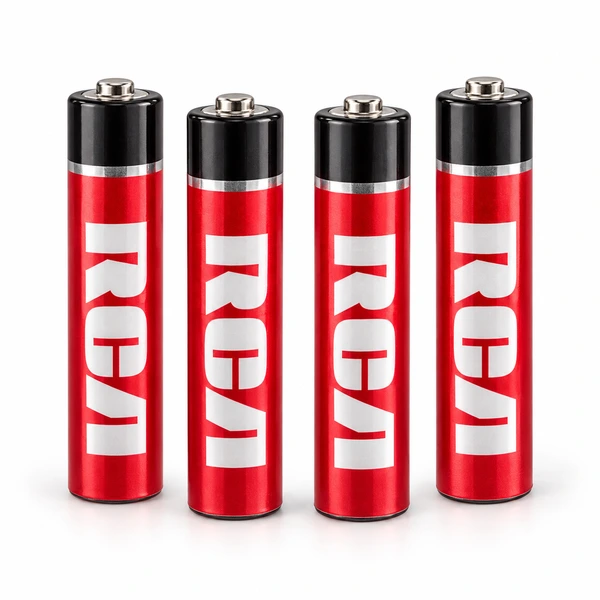](https://raw.githubusercontent.com/conectatech-ec/conectatech-ec.github.io/41bbf55862660043e826d2945b884728f2bfe9a6/imagenes/pila026/PILA026-r2026110344-01.webp) |
| **PILA027** · Pilas RCA AAA \| paquete de 2 | [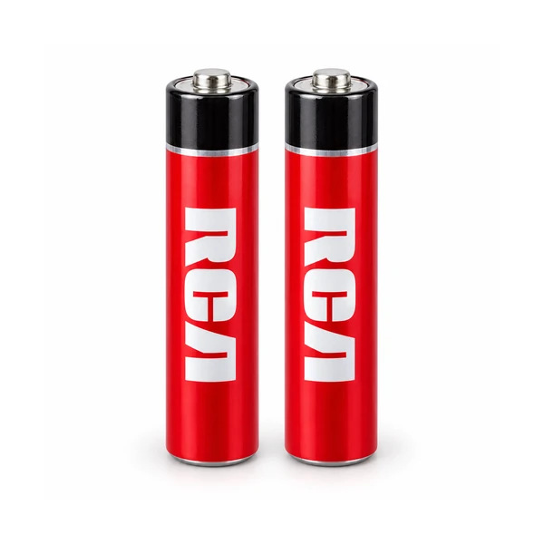](https://raw.githubusercontent.com/conectatech-ec/conectatech-ec.github.io/41bbf55862660043e826d2945b884728f2bfe9a6/imagenes/pila027/PILA027-01.webp) | [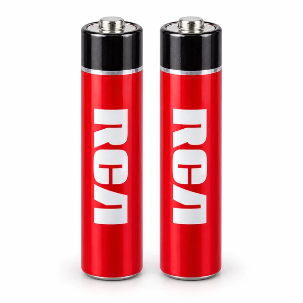](https://raw.githubusercontent.com/conectatech-ec/conectatech-ec.github.io/41bbf55862660043e826d2945b884728f2bfe9a6/imagenes/pila027/PILA027-r2026110344-01.webp) |
| **PILA028** · Pila AAA RCA Pack DE 6 | [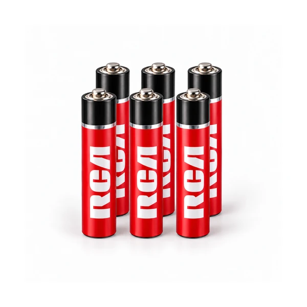](https://raw.githubusercontent.com/conectatech-ec/conectatech-ec.github.io/41bbf55862660043e826d2945b884728f2bfe9a6/imagenes/pila028/PILA028-01.webp) | [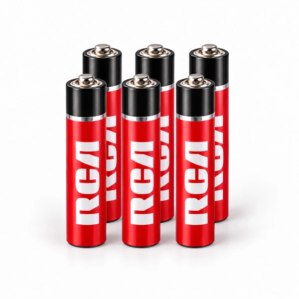](https://raw.githubusercontent.com/conectatech-ec/conectatech-ec.github.io/41bbf55862660043e826d2945b884728f2bfe9a6/imagenes/pila028/PILA028-r2026110344-01.webp) |
| **PILA030** · Pila D RCA | [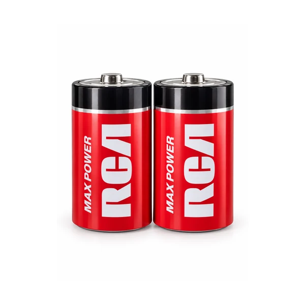](https://raw.githubusercontent.com/conectatech-ec/conectatech-ec.github.io/41bbf55862660043e826d2945b884728f2bfe9a6/imagenes/pila030/PILA030-01.webp) | [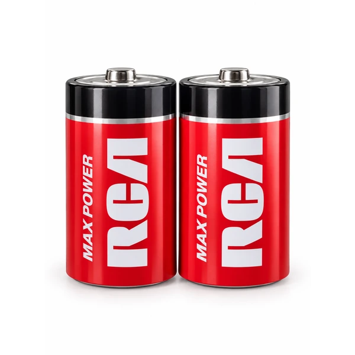](https://raw.githubusercontent.com/conectatech-ec/conectatech-ec.github.io/41bbf55862660043e826d2945b884728f2bfe9a6/imagenes/pila030/PILA030-r2026110344-01.webp) |
| **PILA031** · Pila C RCA | [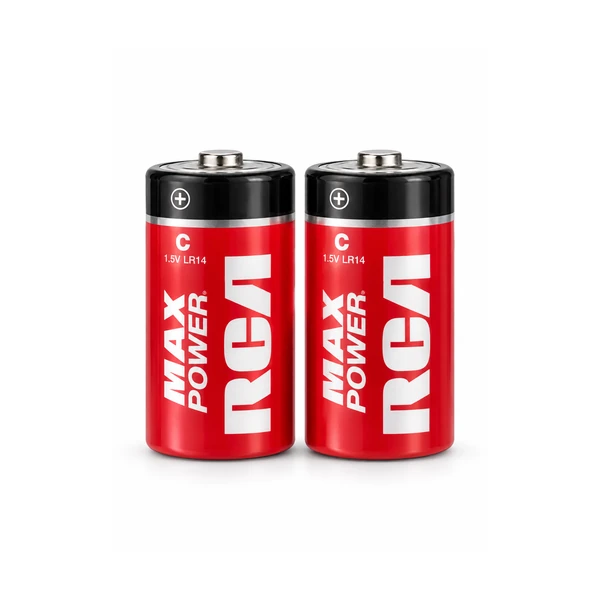](https://raw.githubusercontent.com/conectatech-ec/conectatech-ec.github.io/41bbf55862660043e826d2945b884728f2bfe9a6/imagenes/pila031/PILA031-01.webp) | [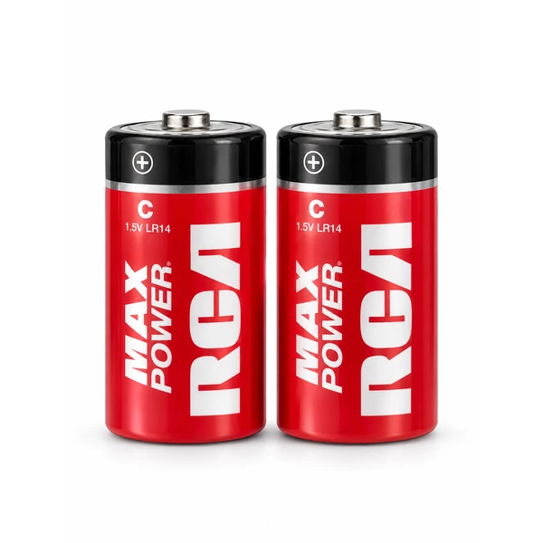](https://raw.githubusercontent.com/conectatech-ec/conectatech-ec.github.io/41bbf55862660043e826d2945b884728f2bfe9a6/imagenes/pila031/PILA031-r2026110344-01.webp) |
| **PILA039** · Pilas Sony AAA \| paquete de 4 | [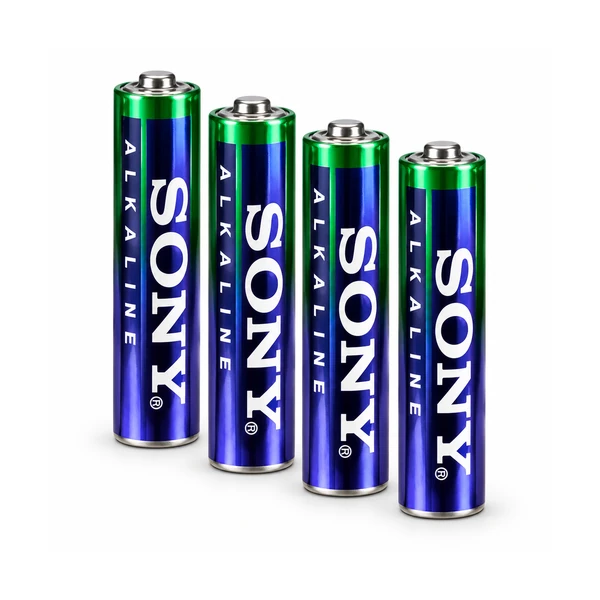](https://raw.githubusercontent.com/conectatech-ec/conectatech-ec.github.io/41bbf55862660043e826d2945b884728f2bfe9a6/imagenes/pila039/PILA039-01.webp) | [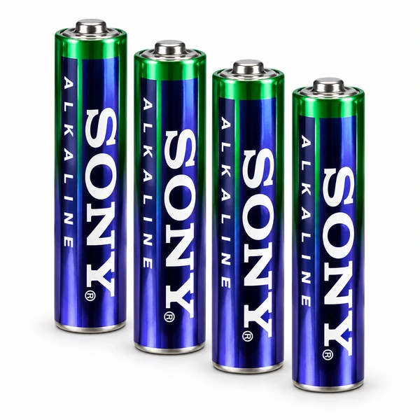](https://raw.githubusercontent.com/conectatech-ec/conectatech-ec.github.io/41bbf55862660043e826d2945b884728f2bfe9a6/imagenes/pila039/PILA039-r2026110344-01.webp) |
| **PILA043** · Pilas recargables Maxday AAA, paquete de 4 | [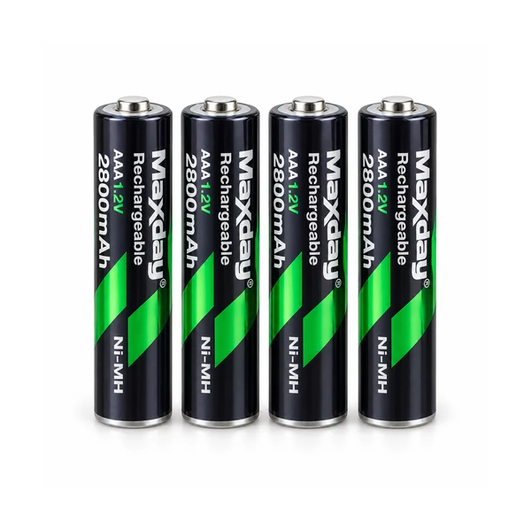](https://raw.githubusercontent.com/conectatech-ec/conectatech-ec.github.io/41bbf55862660043e826d2945b884728f2bfe9a6/imagenes/pila043/PILA043-01.webp) | [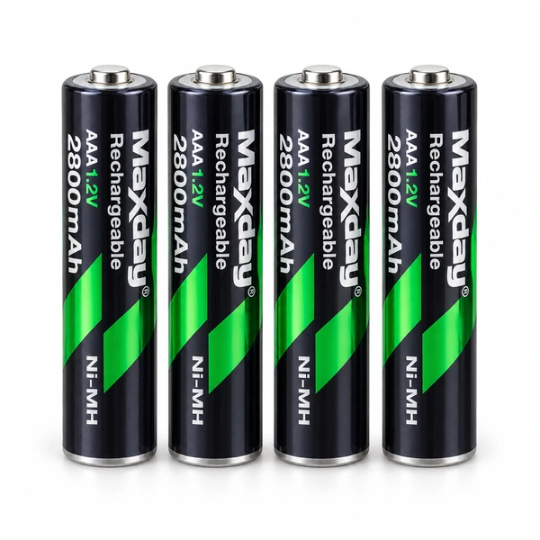](https://raw.githubusercontent.com/conectatech-ec/conectatech-ec.github.io/41bbf55862660043e826d2945b884728f2bfe9a6/imagenes/pila043/PILA043-r2026110344-01.webp) |
| **PILA046** · Pilas recargables Maxday AAA, paquete de 2 | [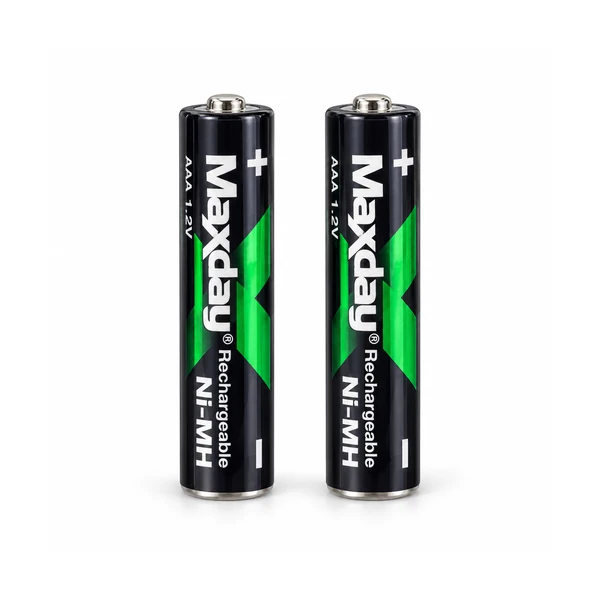](https://raw.githubusercontent.com/conectatech-ec/conectatech-ec.github.io/41bbf55862660043e826d2945b884728f2bfe9a6/imagenes/pila046/PILA046-01.webp) | [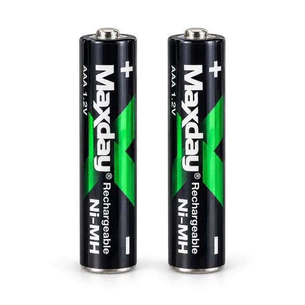](https://raw.githubusercontent.com/conectatech-ec/conectatech-ec.github.io/41bbf55862660043e826d2945b884728f2bfe9a6/imagenes/pila046/PILA046-r2026110344-01.webp) |
| **PILA047** · Pilas recargables Maxday AA, paquete de 2 | [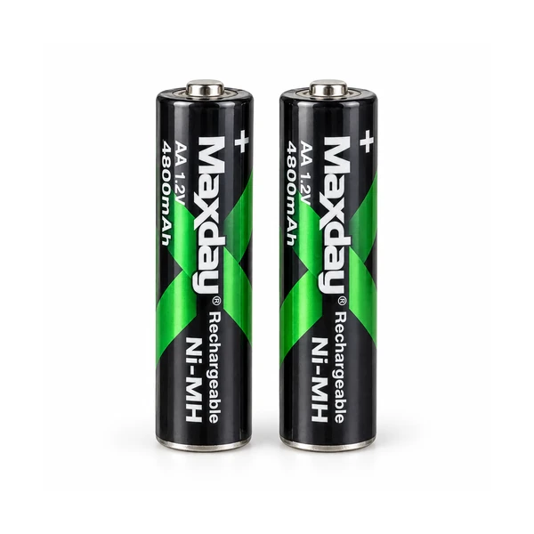](https://raw.githubusercontent.com/conectatech-ec/conectatech-ec.github.io/41bbf55862660043e826d2945b884728f2bfe9a6/imagenes/pila047/PILA047-01.webp) | [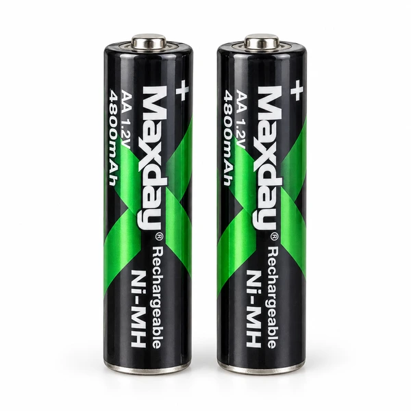](https://raw.githubusercontent.com/conectatech-ec/conectatech-ec.github.io/41bbf55862660043e826d2945b884728f2bfe9a6/imagenes/pila047/PILA047-r2026110344-01.webp) |
| **PILA050** · Pilas RCA AA \| paquete de 2 | [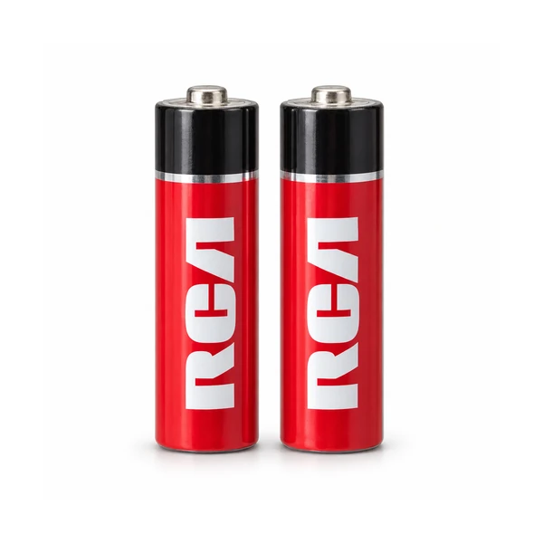](https://raw.githubusercontent.com/conectatech-ec/conectatech-ec.github.io/41bbf55862660043e826d2945b884728f2bfe9a6/imagenes/pila050/PILA050-01.webp) | [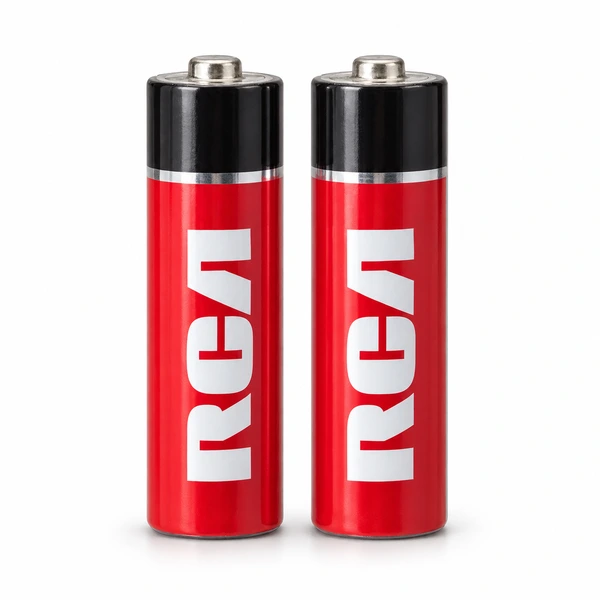](https://raw.githubusercontent.com/conectatech-ec/conectatech-ec.github.io/41bbf55862660043e826d2945b884728f2bfe9a6/imagenes/pila050/PILA050-r2026110344-01.webp) |
| **PILA067** · Pila Aaaa Camelion Pack DE 2 | [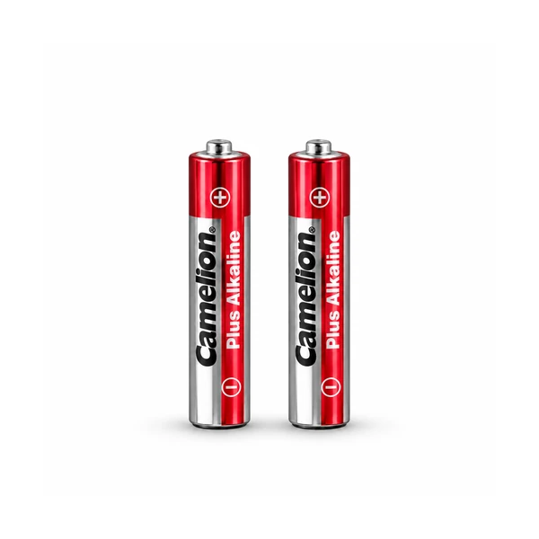](https://raw.githubusercontent.com/conectatech-ec/conectatech-ec.github.io/41bbf55862660043e826d2945b884728f2bfe9a6/imagenes/pila067/PILA067-01.webp) | [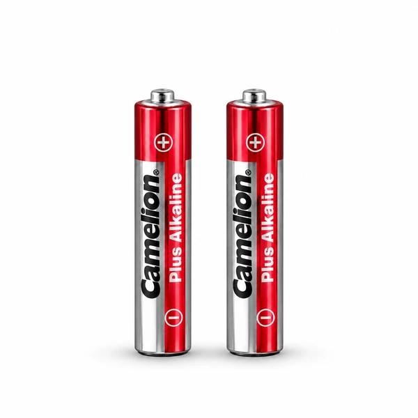](https://raw.githubusercontent.com/conectatech-ec/conectatech-ec.github.io/41bbf55862660043e826d2945b884728f2bfe9a6/imagenes/pila067/PILA067-r2026110344-01.webp) |
| **PILA069** · Pilas Sony AA \| paquete de 4 | [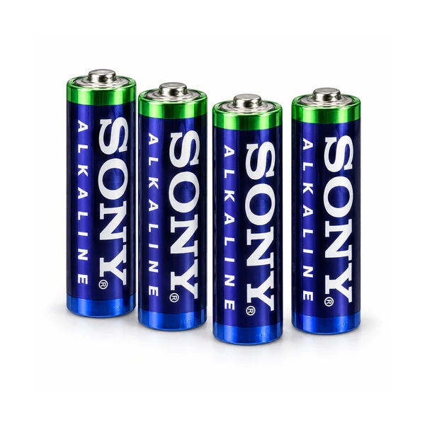](https://raw.githubusercontent.com/conectatech-ec/conectatech-ec.github.io/41bbf55862660043e826d2945b884728f2bfe9a6/imagenes/pila069/PILA069-01.webp) | [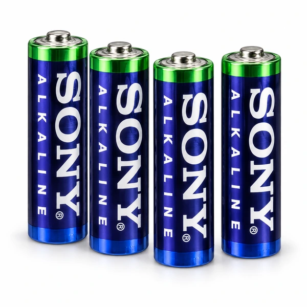](https://raw.githubusercontent.com/conectatech-ec/conectatech-ec.github.io/41bbf55862660043e826d2945b884728f2bfe9a6/imagenes/pila069/PILA069-r2026110344-01.webp) |
| **PILA070** · Pila D Maxday | [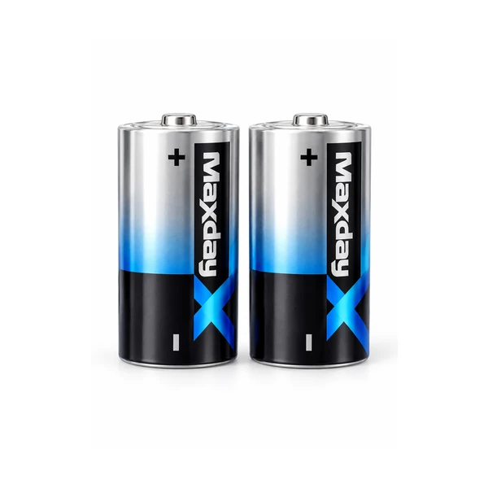](https://raw.githubusercontent.com/conectatech-ec/conectatech-ec.github.io/41bbf55862660043e826d2945b884728f2bfe9a6/imagenes/pila070/PILA070-01.webp) | [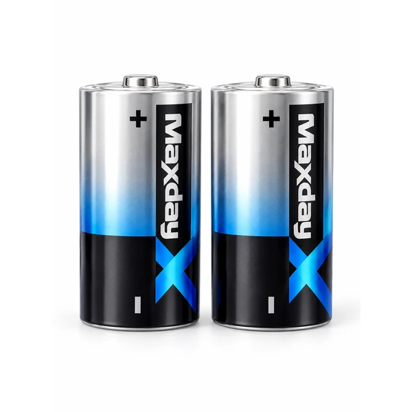](https://raw.githubusercontent.com/conectatech-ec/conectatech-ec.github.io/41bbf55862660043e826d2945b884728f2bfe9a6/imagenes/pila070/PILA070-r2026110344-01.webp) |
| **PILA071** · Pila Soeiniy 27A por unidad | [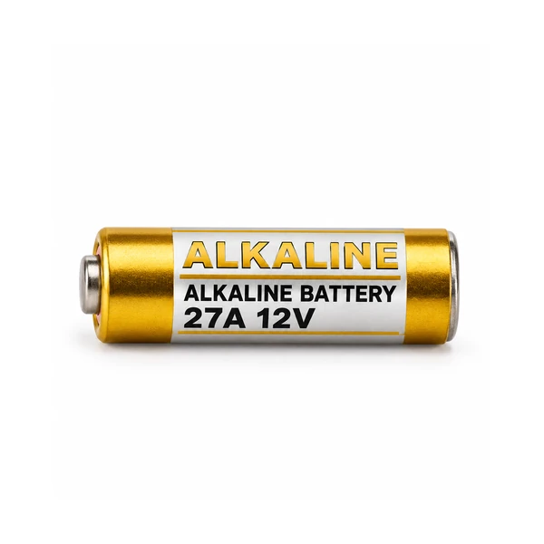](https://raw.githubusercontent.com/conectatech-ec/conectatech-ec.github.io/41bbf55862660043e826d2945b884728f2bfe9a6/imagenes/pila071/PILA071-01.webp) | [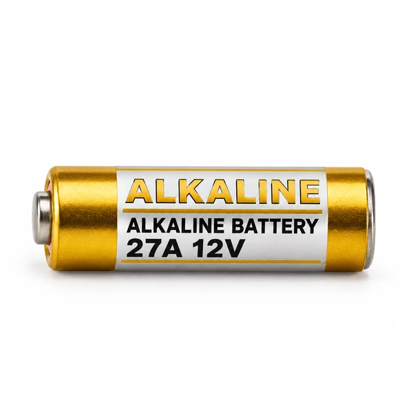](https://raw.githubusercontent.com/conectatech-ec/conectatech-ec.github.io/41bbf55862660043e826d2945b884728f2bfe9a6/imagenes/pila071/PILA071-r2026110344-01.webp) |
| **PILA074** · Pila GP 27A por unidad | [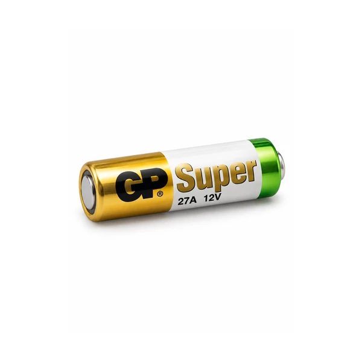](https://raw.githubusercontent.com/conectatech-ec/conectatech-ec.github.io/41bbf55862660043e826d2945b884728f2bfe9a6/imagenes/pila074/PILA074-01.webp) | [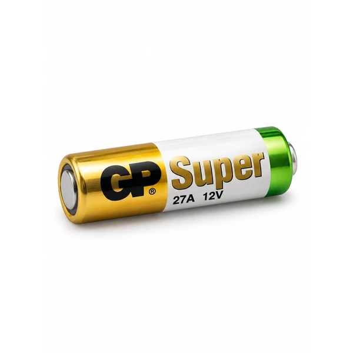](https://raw.githubusercontent.com/conectatech-ec/conectatech-ec.github.io/41bbf55862660043e826d2945b884728f2bfe9a6/imagenes/pila074/PILA074-r2026110344-01.webp) |
| **PILA015** · Pila PKCELL 27A por unidad | [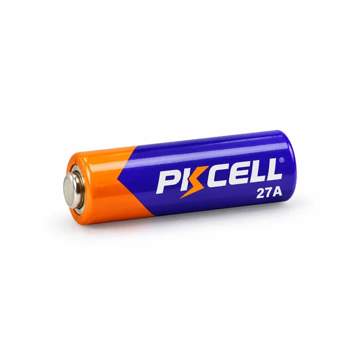](https://raw.githubusercontent.com/conectatech-ec/conectatech-ec.github.io/41bbf55862660043e826d2945b884728f2bfe9a6/imagenes/pila015/PILA015-01.webp) | [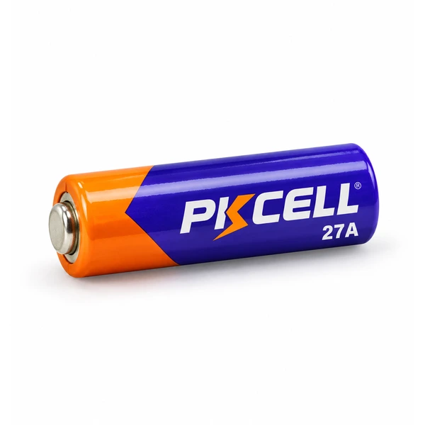](https://raw.githubusercontent.com/conectatech-ec/conectatech-ec.github.io/41bbf55862660043e826d2945b884728f2bfe9a6/imagenes/pila015/PILA015-r2026110344-01.webp) |
| **PILA010** · Pila Sony CR2016 \| unidad | [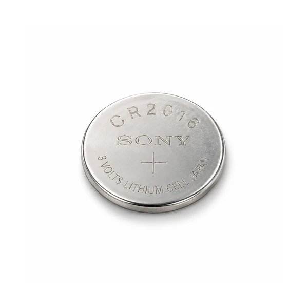](https://raw.githubusercontent.com/conectatech-ec/conectatech-ec.github.io/41bbf55862660043e826d2945b884728f2bfe9a6/imagenes/pila010/PILA010-01.webp) | [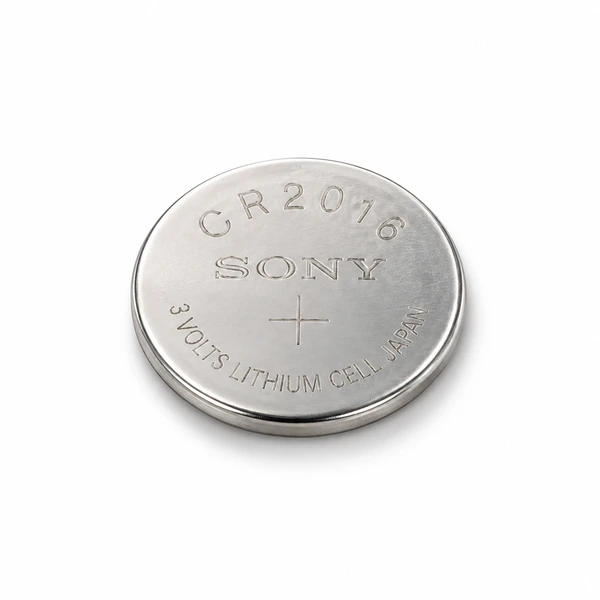](https://raw.githubusercontent.com/conectatech-ec/conectatech-ec.github.io/41bbf55862660043e826d2945b884728f2bfe9a6/imagenes/pila010/PILA010-r2026110344-01.webp) |
| **PILA011** · Pila Sony CR2025 \| unidad | [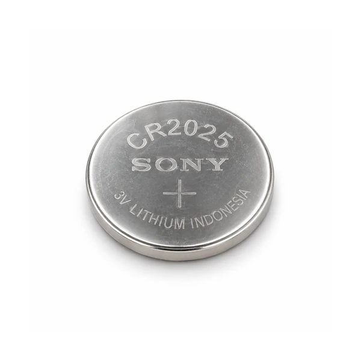](https://raw.githubusercontent.com/conectatech-ec/conectatech-ec.github.io/41bbf55862660043e826d2945b884728f2bfe9a6/imagenes/pila011/PILA011-01.webp) | [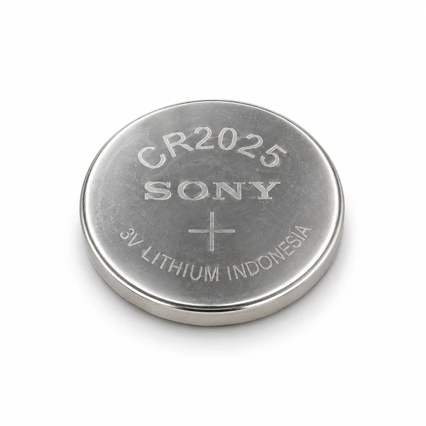](https://raw.githubusercontent.com/conectatech-ec/conectatech-ec.github.io/41bbf55862660043e826d2945b884728f2bfe9a6/imagenes/pila011/PILA011-r2026110344-01.webp) |
| **PILA013** · Pila RCA CR2032 \| unidad | [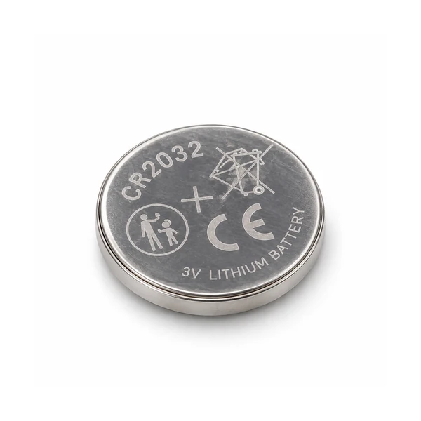](https://raw.githubusercontent.com/conectatech-ec/conectatech-ec.github.io/41bbf55862660043e826d2945b884728f2bfe9a6/imagenes/pila013/PILA013-01.webp) | [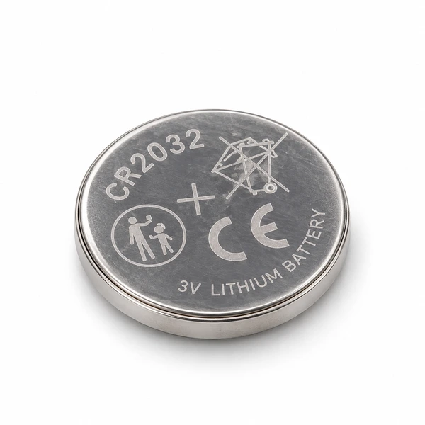](https://raw.githubusercontent.com/conectatech-ec/conectatech-ec.github.io/41bbf55862660043e826d2945b884728f2bfe9a6/imagenes/pila013/PILA013-r2026110344-01.webp) |
| **PILA016** · Pila Murata 364 / SR621SW \| unidad |  |  |
| **PILA017** · Pila Suncom AG1 / LR621 \| unidad |  |  |
| **PILA018** · Pila Murata 371 / SR920SW \| unidad |  |  |
| **PILA019** · Pila Maxday AG6 / 371A \| unidad |  |  |

## Tanda 45 ·27 SKU

| SKU y producto | Antes | Mejora preparada |
| --- | --- | --- |
| **PILA021** · Pila Maxday AG4 / 377A \| unidad |  |  |
| **PILA022** · Pila Suncom AG4 / LR626 \| unidad |  |  |
| **PILA033** · Pila PKCELL AG13 / LR44 \| unidad |  |  |
| **PILA034** · Pila PKCELL AG4 / LR626 |  |  |
| **PILA036** · Pila T&E LR1130 / AG10 \| unidad |  |  |
| **PILA037** · Pila Suncom LR1130 / AG10 \| unidad |  |  |
| **PILA038** · Pila Maxday AG10 \| unidad |  |  |
| **PILA040** · Pila Murata 192 / LR41 \| unidad |  |  |
| **PILA041** · Pila Suncom LR41 / LR192 |  |  |
| **PILA042** · Pila Maxday AG3 \| unidad |  |  |
| **PILA048** · Pila Suncom CR1632 \| unidad |  |  |
| **PILA049** · Pila Suncom CR1616 \| unidad |  |  |
| **PILA052** · Pila Maxday AG0 \| unidad |  |  |
| **PILA053** · Pila Murata CR1220 |  |  |
| **PILA054** · Pila Murata CR2430 \| unidad |  |  |
| **PILA055** · Pila Tianqiu CR1625 \| unidad |  |  |
| **PILA056** · Pila Maxday AG2 \| unidad |  |  |
| **PILA057** · Pila Maxday AG5 \| unidad |  |  |
| **PILA059** · Pila Maxday AG8 \| unidad |  |  |
| **PILA060** · Pila Maxday AG11 \| unidad |  |  |
| **PILA062** · Pila Maxday AG12 \| unidad |  |  |
| **PILA063** · Pila Rayovac tamaño 312 para audífonos |  |  |
| **PILA064** · Pila Rayovac tamaño 675 para audífonos |  |  |
| **PILA065** · Pila Rayovac tamaño 13 para audífonos |  |  |
| **PILA066** · Pila Rayovac tamaño 10 para audífonos |  |  |
| **PILA068** · Pila Murata CR1632 \| unidad |  |  |
| **PILA075** · Pila Suncom CR1620 |  |  |

## Conservación y pendientes

Todos los originales y sus hashes se conservan. No se modificaron títulos, precios, existencias, SKU ni enlaces.

Las seis pilas sin inscripción del modelo legible mantienen sus fotografías actuales. No se inventan inscripciones ni se sustituyen por modelos parecidos.
